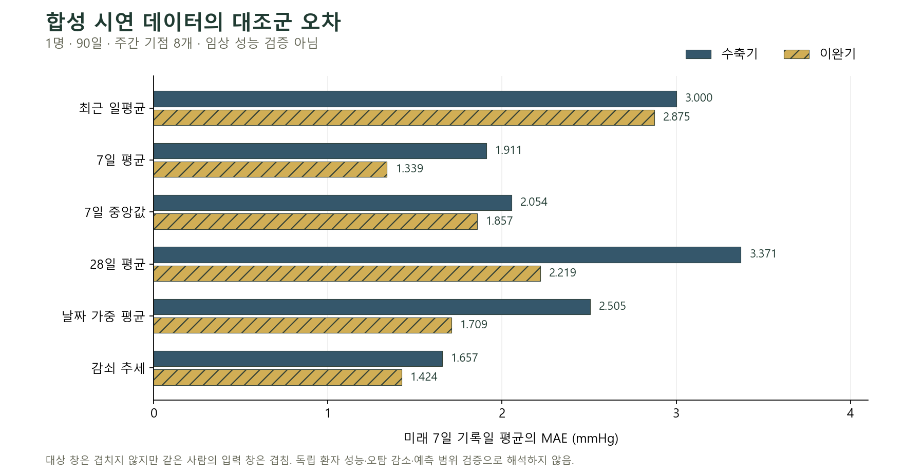

# 혈압 이력 예측 설계 검증

합성 시연 페르소나 1명 · 90일 · 180회. 임상 성능 검증이 아니다. 운영 모델은 선택하거나 교체하지 않았다.

| 고정 대조군 | 주간 기점 수 | SBP MAE mmHg | DBP MAE mmHg | SBP 편향 mmHg |
| --- | ---: | ---: | ---: | ---: |
| last_daily | 8 | 3.000 | 2.875 | 0.571 |
| mean_7d | 8 | 1.911 | 1.339 | 1.304 |
| median_7d | 8 | 2.054 | 1.857 | 1.196 |
| mean_28d | 8 | 3.371 | 2.219 | 3.299 |
| ewma_7d | 8 | 2.505 | 1.709 | 2.197 |
| damped_trend_28d | 8 | 1.657 | 1.424 | 0.431 |

대상 창은 겹치지 않지만 같은 사람이고 입력 창도 겹친다. 주간 기점 8개를 독립 환자 8명으로 해석하지 않는다. 일별 기점 비교는 겹치는 창을 사용하므로 보조 진단만 한다.

기본 시연의 미래 높은 평균 사건은 양성 8개·음성 0개다. 음성 분모가 없어 FPR은 null이며 오탐 감소를 입증할 수 없다. 기존 M1의 같은 방문 고혈압 분류와도 직접 비교하지 않는다.

모든 대조군이 평가 가능한 공통 기점과 모델별 보류·정답 확보 분모를 별도로 보존한다.

## 현재 기점

다음 7일은 아직 관측되지 않았으므로 현재 기점의 오차·정확도는 평가하지 않는다. 예측 범위는 독립적인 실제 기록으로 보정되기 전까지 null이다.

## 보류 시나리오

- unchanged_video_persona: research_only
- sparse_every_third_day: abstained · insufficient_history_days, insufficient_recent_days, insufficient_paired_days, stale_measurements
- morning_only: abstained · insufficient_paired_days
- missing_last_four_days: abstained · insufficient_recent_days, stale_measurements
- clinic_only: abstained · insufficient_history_days, insufficient_calendar_span, insufficient_recent_days, insufficient_paired_days, stale_measurements
- unknown_protocol: abstained · insufficient_history_days, insufficient_calendar_span, insufficient_recent_days, insufficient_paired_days, stale_measurements
- date_unknown: abstained · insufficient_history_days, insufficient_calendar_span, insufficient_recent_days, insufficient_paired_days, stale_measurements
- device_changed: abstained · device_change_in_lookback
- stable: research_only
- late_increase: research_only
- noisy: research_only
- single_extreme: abstained · outside_research_support
- known_medication_change: abstained · recent_medication_change

## 재현

```powershell
python -m unittest discover -s ai/bp_forecast/tests -v
python -m ai.bp_forecast.run_demo --out .cache/bp-forecast-design
```

08:00/20:00·수신 지연·기기·가정 측정·프로토콜 메타데이터는 시험을 위한 가정이다. 이를 실제 측정 메타데이터나 학습 데이터로 재사용하지 않는다.


