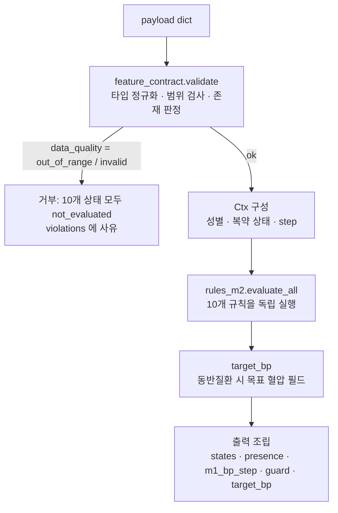
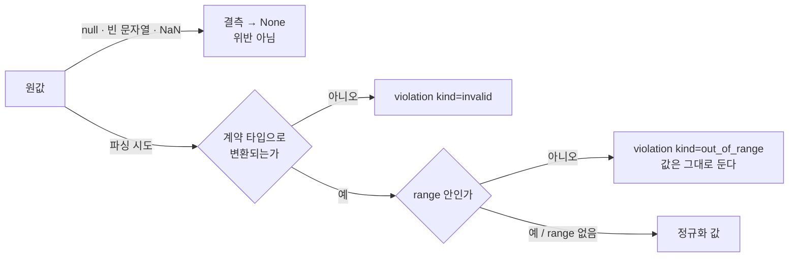
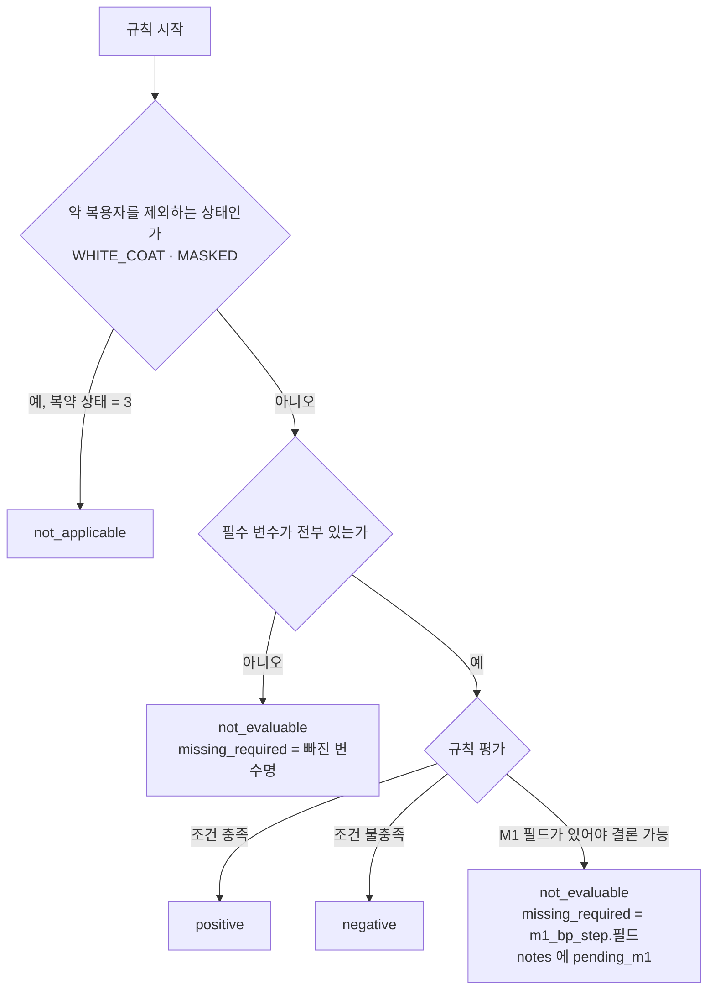

# M2 작동 원리 — 혈압 관련 상태 판정 모듈 (v0.2.0)

이 문서는 `ai/m2_state/` 가 입력을 받아 A군 10개 상태를 어떻게 판정하는지 처음부터 끝까지 설명한다.
규칙의 정확한 조건은 `rules_spec.md`, 호출 형식과 필드는 `api_spec.md`, 아직 정해지지 않은 항목은 `decisions_needed.md` 에 있다.

## 1. 한눈에 보기

```
M1-S (ai/m1_stage)            M2 (ai/m2_state)                         화면·퀘스트
혈압 4단계 step ─────────┐
                         ├──▶  계약 검증 → 규칙 10개 → 상태 코드·숫자  ──▶  문구 템플릿 / Quest Ranker
앱 생활 데이터(7~20) ────┘
```

- **입력**: M1-S 가 분류한 혈압 단계 `step`(normal / elevated / prehtn / htn) 하나와, 앱이 모은 생활 데이터 13개 변수(맥박, 증상, 나이·성별, 신체계측, 복약, 흡연·음주, 수면, 식단, 활동, 검진 2종, 가족력, 임상검사).
- **출력**: A군 10개 상태 각각의 `status` 와 근거 숫자(`evidence`). 문구는 만들지 않는다.
- **하지 않는 것**: 혈압 수치를 받거나 계산하지 않는다. 7일 평균, 참고 밴드, 가드(≥180/120, <90/60), 2기 범위, 수축기 단독 판별, 아침·저녁·진료실 구분은 전부 M1 쪽이다.
- **성격**: 임계값 규칙만 있다. 학습 모델은 없다. 같은 입력이면 항상 같은 출력이 나온다.

## 2. 처리 흐름



호출은 `inference.judge_m2.judge(payload, as_of=None)` 한 함수다. 내부 순서는 다음 네 단계이고, 각 단계는 아래 절에서 설명한다.

| 단계 | 모듈 | 하는 일 | 결과 |
|---|---|---|---|
| ① 검증 | `feature_contract.py` | 값을 계약 타입으로 바꾸고, 범위를 확인하고, 변수가 "있는지" 판정 | `data_quality`, `violations`, `presence`, 정규화 payload |
| ② 컨텍스트 | `inference/judge_m2.py` | 규칙이 공통으로 쓰는 값 추출 | 성별, 복약 상태, step |
| ③ 규칙 | `rules_m2.py` | 상태별 함수 10개 실행 | 상태마다 `StateResult` |
| ④ 조립 | `inference/judge_m2.py` | 결과를 한 dict 로 | `api_spec.md` 의 응답 |

## 3. ① 검증 — 계약(feature_contract.yaml)이 원본

### 3.1 계약이 정하는 것

변수마다 이름, 필드, 타입, 단위, 범위, 허용값, 존재 조건, 어느 상태에 필수(●)·보조(○)인지를 적는다. 코드는 이 파일을 읽어서 동작하므로, 규칙 코드 어디에도 "변수 X 는 상태 Y 에 필수" 같은 목록이 따로 없다.

### 3.2 값 하나가 지나는 길



- **결측은 위반이 아니다.** 결측은 "없음"으로 남고, 그 변수가 필수인 상태만 `not_evaluable` 이 된다.
- **범위 밖은 클리핑하지 않는다.** 값을 바꾸지 않고 위반으로 기록한 뒤 입력 전체를 거부한다. 한 필드의 오류가 다른 상태 판정에 섞여 들어가지 않게 하기 위해서다.
- **형식 오류**(예: `step` 에 `"PREHTN"` 처럼 허용값 밖 문자열, 숫자 자리에 글자)도 거부한다. 대소문자·공백 정규화는 하지 않는다.
- 우선순위: `out_of_range` 가 하나라도 있으면 `out_of_range`, 아니면 형식 오류가 있을 때 `invalid`, 둘 다 없으면 `ok`.

### 3.3 변수가 "있다"는 뜻 — presence

변수마다 `present_if` 가 있다. `all` 에 적힌 필드가 전부 비결측이고 `any` 에 적힌 필드 중 하나라도 비결측이면 그 변수는 있다. 예를 들어 `age_sex` 는 `sex` 가 있고 `birth_date` 또는 `age` 중 하나가 있어야 한다. `symptom_flags` 는 아홉 개 중 하나라도 값이 있으면(전부 false 여도) 있다.

presence 는 응답에 그대로 실리므로, 어떤 변수가 빠져서 `not_evaluable` 이 됐는지 호출자가 바로 알 수 있다.

## 4. ② 컨텍스트

규칙이 공통으로 쓰는 세 값만 뽑는다. 성별(위험인자의 허리둘레 기준이 남녀로 나뉠 때 사용), 복약 상태 코드(1 진단 없음 / 2 진단·미치료 / 3 약 복용 중), 그리고 `m1_bp_step` 이 있을 때의 `step`. 만 나이 계산은 지금 어떤 규칙도 쓰지 않아 넣지 않았다(ISH 의 연령 기준이 정해지면 추가).

## 5. ③ 규칙 — 상태마다 하나의 함수

### 5.1 모든 규칙이 같은 순서로 움직인다



- 필수 변수 목록은 계약의 `required_for` 에서 읽는다. 보조 변수는 판정을 바꾸지 않고, 있으면 `auxiliary_present` 에 이름만 적는다.
- `not_applicable` 은 결측보다 먼저 본다. 약 복용자는 다른 데이터가 어떻든 WHITE_COAT·MASKED 대상이 아니기 때문이다(해석 D-16).
- 10개 규칙은 서로 독립이다. 한 사용자가 여러 상태에서 동시에 `positive` 일 수 있고, 표시 우선순위는 M2 가 정하지 않는다(`display_priority = null`, D-20).

### 5.2 구현된 4개 — step 과 생활 데이터로 결론이 난다

| 상태 | 결론 내는 방식 | 왜 이렇게 되는가 |
|---|---|---|
| ELEVATED | `step == elevated` 면 positive, 아니면 negative | 원 명세의 "가정 7일 평균 참고 밴드 115~124/75~79" 를 M1 이 step 으로 환산해 준다고 보고, M2 는 그 결과만 읽는다 |
| PREHTN | `step == prehtn` 면 positive. 위험인자는 **목록으로만** 낸다 | 위험인자(현재 흡연, 폭음, 짠 식습관, 식단 사진 플래그, 가족력)는 화면 카드용이고 판정 조건이 아니다(D-13). BMI·허리둘레·활동량은 기준값이 미정이라 `risk_factors_pending` 에 이름만 적는다(D-07) |
| HTN_SUSPECT | 복약 상태 1·2 면 `step == htn` 으로 결론. 복약 상태 3 이면 결론 보류 | M1 의 htn 은 "혈압 ≥140/90 **또는** 항고혈압제 복약"이다. 약을 먹는 사람은 혈압이 낮아도 htn 이므로 step 만으로는 혈압 수준을 알 수 없다. 그래서 `bp_level_step`(복약 조항을 뺀 단계)을 기다린다(D-31) |
| NOCTURNAL_SCREEN | 코골이·주간졸림·야뇨 중 2개 이상이면 positive. 미만이면 결론 보류 | 원 규칙은 "저녁 평균 ≥135/85 **또는** 증상 2개 이상"의 OR 다. 증상 분기만 충족해도 positive 는 확정되지만, 증상이 모자랄 때 저녁 분기를 모르면 negative 를 확정할 수 없다. 그래서 `evening_step` 을 기다린다(D-32). 야뇨는 수면 문항(13)과 증상 문항(8) 어느 쪽에 있어도 센다(D-18) |

### 5.3 M1 대기 6개 — 지금 결정 가능한 부분만 판정한다

| 상태 | 지금 내는 결론 | 기다리는 M1 필드 |
|---|---|---|
| HTN_STAGE2_SCREEN | 항상 보류 | `stage2_flag` (1회라도 ≥160/100) |
| ISH | 항상 보류 | `ish_flag` (수축기만 높음) |
| WHITE_COAT | 복약자 → not_applicable. 그 외 보류 | `office_step` |
| MASKED | 복약자 → not_applicable. 그 외 보류 | `office_step` |
| MORNING | 항상 보류 | `morning_step`, `evening_step` |
| RESISTANT_SUSPECT | 복용 중 아님 → negative. 복용 중 + 3제 이뇨제 아님 → negative. 복용 중인데 3제 여부 결측 → not_evaluable(`medication.triple_with_diuretic`). 복용 중 + 3제 이뇨제 → 보류 | `bp_level_step` |

"보류"는 `status = not_evaluable`, `missing_required = ["m1_bp_step.<필드>"]`, `notes` 에 `pending_m1` 이다. 결측으로 인한 `not_evaluable` 과 같은 상태 코드를 쓰지만, `missing_required` 의 접두사 `m1_bp_step.` 으로 구분한다. 호출자는 이 접두사를 보고 "사용자가 입력을 더 해도 바뀌지 않는다"를 알 수 있다.

### 5.4 pending 필드가 들어오면 어떻게 켜지는가

계약의 `m1_bp_step` 에는 `status: pending_m1` 필드 7개가 미리 있다. 지금도 값이 오면 타입·허용값 검증은 하지만 규칙은 읽지 않는다(테스트 `test_step_pending_fields_accepted_but_unused` 가 고정). M1 이 어떤 필드를 확정하면 작업은 네 가지다.

1. 계약에서 그 필드의 `status: pending_m1` 을 지우고 버전을 올린다.
2. 해당 규칙 함수에서 `_pending(...)` 호출을 실제 조건으로 바꾼다(조건은 `m1_interface.md` 의 매핑표).
3. 테스트 기대표(`tests/test_rules_step.py`, `test_rules_medication.py`, `tests/cases.py` 의 `EXPECTED_CANON`)를 바꾼다.
4. 골든 20건을 다시 만들고(`scripts/make_golden.py`) 검토받는다.

## 6. 목표 혈압 필드 (A군 판정과 독립)

검진 값(공복혈당·HbA1c, 크레아티닌·요단백)으로 당뇨·CKD 동반이 확인되면 `target_bp` 를 130/80 으로 낸다. 확인 기준 수치가 아직 없어(D-06) 지금은 항상 `null` 이며, 기준을 `thresholds.py` 에 넣으면 바로 동작한다. 이 필드는 A군 규칙에 영향을 주지 않는다(명세 "목표 혈압 필드만 바꾼다").

## 7. ④ 출력 조립 — 코드와 숫자만

응답에는 상태 코드, 숫자, 불리언, 변수·필드 이름만 들어간다. 한글을 포함한 어떤 문구도 넣지 않으며, 금지 표현("진단", "고혈압입니다", "발병 확률")과 비ASCII 문자가 없음을 테스트가 모든 상태·복약 조합에서 확인한다. 화면 문구는 별도 템플릿이 상태 코드와 evidence 로 만든다.

응답 필드의 뜻과 예시는 `api_spec.md` 에 있다.

## 8. 설계 원칙이 코드에 어떻게 박혀 있는가

| 원칙 | 구현 위치 | 지키는 장치 |
|---|---|---|
| 임계값은 한 곳 | `thresholds.py` | 다른 모듈은 `import thresholds as T` 로 호출 시점에 읽는다. 결정 대기 값은 `None` 이고 `None` 이면 해당 분기를 적용하지 않는다 |
| 입력 정의는 한 곳 | `feature_contract.yaml` | 검증·변환·필수 목록·존재 조건을 전부 여기서 읽는다. 바꾸면 `version` 을 올린다 |
| 클리핑 금지 | `feature_contract._check_field` | 범위 밖 값은 그대로 두고 위반으로 기록, 입력 전체 거부 |
| 규칙은 독립 | `rules_m2.evaluate_all` | 10개 함수를 차례로 호출할 뿐 서로의 결과를 보지 않는다 |
| 결정은 사용자가 | `decisions_needed.md` | 명세에 없는 값은 `None` 으로 두거나 해석에 `D-nn` 번호를 달아 문서에 모은다 |
| 독립 패키지 | `pyproject.toml`(pythonpath=".") | 상위 `ai/` 나 `m1_stage/` 를 import 하지 않는다. 이 폴더 안에서 실행한다 |

## 9. 검증이 원리를 어떻게 보장하는가

| 테스트 | 확인하는 것 |
|---|---|
| step 값별 | step 4값 × 상태마다 기대 status 표. 대기 상태는 step 과 무관하게 같은 결과 |
| 결측 | 상태별 필수 변수를 하나씩 빼면 `not_evaluable` 이 되고 `missing_required` 에 그 이름만 적힌다. 보조 변수를 빼도 결과가 같다 |
| 복약 상태 | 상태 × 복약 1·2·3 기대표. WHITE_COAT·MASKED 의 `not_applicable`, HTN_SUSPECT·RESISTANT 의 보류 |
| 계약 | 범위 밖 거부(값 보존), 형식 오류, 존재 규칙, pending 필드 수용, 평탄 표 왕복 변환, 컬럼 대조 |
| 출력 표현 | 금지 표현·비ASCII 없음, 스키마 키, 목표 혈압 전환 |
| 골든 20건 | 상태별 2건의 입력과 출력을 고정(초안). 코드를 바꾸면 달라진 곳이 드러난다 |

`scripts/report_tests.py` 가 규칙 × 테스트 종류 표를 `test_results.md` 로 만든다.

## 10. 배치(표) 입력 경로

표 한 장(한 행 = 사용자 한 명, 컬럼 `<변수>__<필드>`)을 받을 때는 `feature_contract.from_table` 이 행을 payload 로 바꾸고 같은 `judge` 를 호출한다. `scripts/apply_data.py` 는 이 경로로 컬럼 대조 → 결측률·범위 위반 → 상태별 판정 분포 → 상태 간 동시 발생표를 보고서로 만든다. 데이터 파일은 커밋하지 않는다.

## 11. 알아 둘 한계

- step 의 기준선(120/80, 130/80~, 140/90)은 원 명세의 가정혈압 참고 밴드(115/75, 125/80, 135/85)와 다르다. M2 는 M1 의 분류를 그대로 받아들이고 조정하지 않는다.
- 복약자는 M1 정의상 항상 htn 이라, step 만으로는 혈압 정보가 없다. 복약자인데 step ≠ htn 인 입력은 M1 정의와 어긋나지만 M2 는 거부하지 않고 데이터 보고에서 건수만 센다(D-30).
- §2 가드(≥180/120, <90/60 → A군 중단·증상 문항 분기)는 M1 의 `guard_flag` 가 정의되면 연결한다. 지금 응답의 `guard.triggered` 는 항상 `null` 이다.
- 변수 범위는 전부 임시값이다(D-10).
