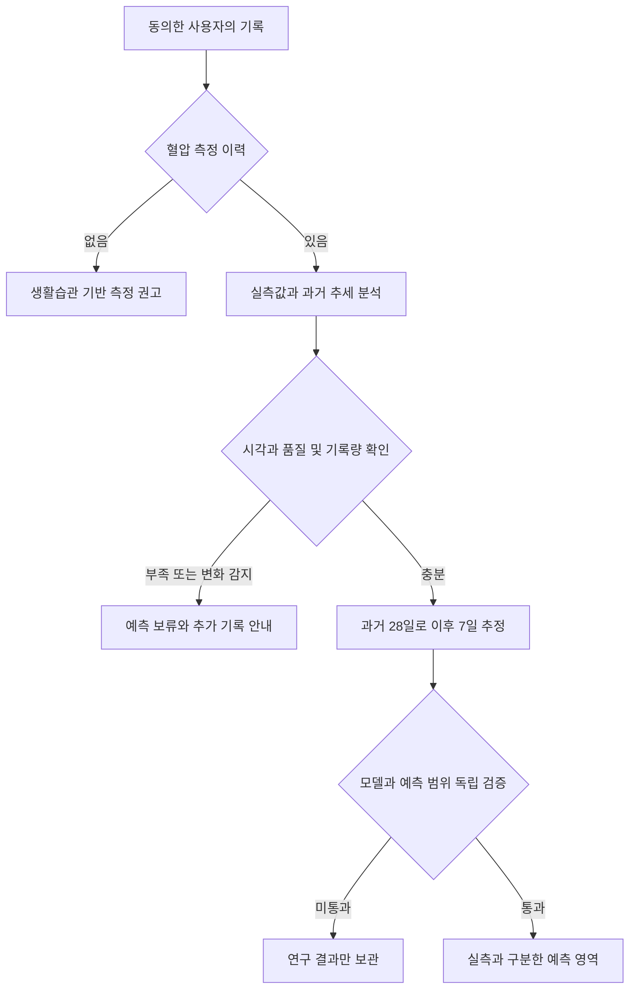

# 과거 혈압 이력을 이용한 예측 설계

2026년 11월 2일 · 설계와 독립 연구 프로토타입 · 브랜치 `feature/dashboard-htn-sensitivity`

**측정 기록 분석, 생활습관 선별, 미래 혈압 예측을 서로 다른 결과로 유지한다.** 첫 예측 목표는 최근 28일의 과거 가정혈압 기록으로 다음 7일의 기록일 평균 수축기·이완기 혈압을 추정하는 것이다. 고혈압 확진, 야간혈압, 약의 효과 또는 심혈관 사건 위험을 이 값으로 대신하지 않는다.

현재 운영 경로에는 앞서 만든 측정 기록 분석과 생활습관 측정 권고가 유지된다. 이번에 추가한 `ai/bp_forecast`는 운영 API에 등록되지 않은 연구 모듈이다. v9와 기존 M1 확률은 예측 입력으로 사용하지 않는다. 실제 개인별 종단 자료의 독립 검증과 예측 범위 보정 전에는 사용자에게 미래 혈압 수치를 제공하지 않는다.

## 역할과 결과의 경계

| 경로           | 답하는 질문                                              | 입력                                         | 결과와 다음 행동                                                              |
| -------------- | -------------------------------------------------------- | -------------------------------------------- | ----------------------------------------------------------------------------- |
| 측정 기록 분석 | 지금까지 실제로 무엇이 기록됐는가                        | 선택 기간의 측정값                           | 최근 값, 일별 평균, 변동, 아침·저녁 차이, 기록률. 필요하면 측정·상담으로 연결 |
| 생활습관 선별  | 측정하지 않은 사용자에게 측정을 권할 정보가 있는가       | 혈압을 제외한 생활습관·기본 정보             | 측정 권고와 근거 항목. 음성 신호도 정상 확진으로 표시하지 않음                |
| 혈압 이력 예측 | 과거 기록을 기준으로 다음 주 기록일 평균은 어느 정도인가 | 예측 시점까지 이용 가능했던 과거 측정과 문맥 | 별도 예측값, 대상 기간, 보정된 예측 범위, 보류 사유                           |

측정 기록이 적거나 오래됐다고 측정 경로를 생활습관 단계 추정으로 대체하지 않는다. 기록은 그대로 보여 주고 미래 예측만 보류한다. 측정일이 없는 프로필 혈압은 별도로 표시하며 시계열 입력에는 넣지 않는다. Health Score는 생활습관 실천 점수로 유지한다.

## 예측 목표를 먼저 고정한다

### 첫 목표

`next_7d_recorded_home_daily_mean`을 수축기와 이완기에 각각 정의한다.

- 기준 시점 `t`는 서버가 실제로 사용할 수 있었던 정보의 마감 시각이다. 시간대는 첫 버전에서 한국 표준시로 고정한다.
- 입력은 `date(t)-27일`부터 `t`까지다. 관측 시각과 서버 수신 시각이 모두 `t` 이하여야 한다.
- 정답 창은 `date(t)+1일`부터 `date(t)+7일`까지다. 입력 날짜를 정답에 겹쳐 넣지 않는다.
- 각 세션 반복 측정 평균 → 아침·저녁 슬롯별 평균 → 두 슬롯의 일평균 → 기록일을 같은 비중으로 평균한다.
- 정답은 아침·저녁이 모두 있는 날이 최소 5일일 때만 만든다. 누락된 날이나 슬롯은 0이나 보간값으로 채우지 않는다.
- 따라서 정확한 목표는 **다음 7일 중 표준 가정 측정이 기록된 날의 평균**이다. 관측되지 않은 모든 날의 참 혈압 평균을 안다고 주장하지 않는다. 7일 완전 기록만 사용한 민감도 분석을 병행한다.
- 정답 창 종료 2일 뒤에 라벨을 동결하는 지연 허용 정책을 연구용으로 둔다. 그 뒤 들어온 수정은 이전 평가 라벨을 조용히 바꾸지 않고 별도 개정 버전으로 관리한다.

측정 방법과 진단 경계는 환경에 따라 다르다. 국내 지침의 가정혈압과 진료실 혈압 기준을 같은 라벨로 섞지 않는다. 연구의 보조 사건은 ‘다음 주 기록일 평균 SBP ≥135 또는 DBP ≥85’로 정의하며, 이 사건을 고혈압 확진이나 개인별 치료 목표로 해석하지 않는다. [대한고혈압학회 가정혈압 입장문](https://pmc.ncbi.nlm.nih.gov/articles/PMC9526300/)

### 다른 목표의 채택 조건

첫 임상 검증 모집단은 성인 가정혈압 사용자로 정한다. 임신·산후, 미성년, 부정맥으로 기기 정확도 확인이 필요한 경우, 투석·급성 입원·기립성 측정처럼 다른 프로토콜이 필요한 상황은 별도 자료와 검증 전까지 같은 모델의 적용 대상으로 묶지 않는다. 고령·복약·당뇨 집단은 충분한 관측과 그룹별 평가가 필요하다. 연구 코드의 숫자 품질 통과는 이러한 임상 적용 자격의 통과를 뜻하지 않는다.

| 목표                                  | 장점                                               | 주요 문제                                              | 순서                               |
| ------------------------------------- | -------------------------------------------------- | ------------------------------------------------------ | ---------------------------------- |
| 다음 날 아침 혈압                     | 행동 안내와 연결하기 쉬움                          | 일중·일별 잡음, 아침 기록 누락, 시간대 오차            | 7일 평균 검증 뒤 별도 모델         |
| 다음 7일 기록일 평균                  | 단일 측정보다 안정적인 목표, 현재 설문과 연결 가능 | 기록한 날에 조건부인 결과, 미래 복약·질병 변화         | 첫 목표                            |
| 다음 7일 높은 평균 여부               | 측정 확인 행동과 연결                              | 기준 부근 오탐, 사건 빈도와 보류율 영향을 함께 봐야 함 | 회귀·범위 검증 뒤 보조 결과        |
| 향후 30일 평균·악화                   | 장기 관리에 유용                                   | 긴 라벨 지연, 치료·기기·생활 변화가 누적               | 충분한 관측 기간 뒤                |
| 향후 수년 고혈압 신규 발생            | 예방 목적                                          | 현재 고혈압·복약자를 별도 취급해야 하며 진단 추적 필요 | 별도 코호트와 과제                 |
| 야간 고혈압·수면 중 하강              | 임상적 관심                                        | 취침 전 혈압은 수면 중 혈압이 아님                     | ABPM 등 실제 야간 자료 전에는 제외 |
| 약 변경·걷기·수면 개선 시 예상 감소량 | 개인화된 가정 비교                                 | 관찰 자료의 연관은 개입 효과가 아님                    | 인과 설계 없이 제공하지 않음       |

현재 M2의 증상 선별 항목도 수면 중 혈압 측정이나 확진으로 바뀌지 않는다. 예측을 M1의 단계 필드에 끼워 넣어 M2나 Sub Quest를 작동시키지 않는다. 향후 연동은 별도 목적과 계약으로 검증한다.

## 현재 자료의 적합성

| 자료                                          | 확인한 구조                                  | 사용할 수 있는 범위           | 부족한 부분                                                                   |
| --------------------------------------------- | -------------------------------------------- | ----------------------------- | ----------------------------------------------------------------------------- |
| 기존 국민건강영양조사 원자료와 확장 학습 경로 | 방문별 측정·생활습관, 연도별 분할            | 생활습관 선별, 횡단면 비교    | 같은 사람의 매일 반복 측정과 이후 7일 정답이 아님                             |
| 앱 `dailySurveys`                             | 날짜, 아침·저녁 혈압, `submittedAt`          | 관측값·일평균·과거 추세       | 측정별 시각·환경·기기·불변 개정 이력 없음                                     |
| `healthHistory`                               | 날짜별 스냅샷, 주로 마지막 측정값            | 기존 화면 호환                | 독립 측정 원자료가 아니며 설문과 중복 가능                                    |
| 프로필 혈압                                   | 날짜 없는 문자열                             | 날짜 미확인 값으로 표시       | 시계열 학습·기간 평균에는 사용 불가                                           |
| `game_saves`와 `sync_batches`                 | 최신 JSON 덮어쓰기, 배치 수신 시각·해시·응답 | 계정 동기화·중복 배치 방지    | 과거 측정 원문 전체의 불변 저장소가 아님. 해시만으로 과거 값을 복구할 수 없음 |
| 90일 시연 페르소나                            | 1명의 합성 90일, 180회 아침·저녁 값          | 흐름·누수 방지·보류 로직 검증 | 실제 환자 성능·성별·연령 일반화·예측 범위 검증 불가                           |

로컬 원자료·계약·코드 검토 범위에서 실제 개인별 일별 예측 학습 코호트를 확인하지 못했다. 운영 환자 DB를 조회해 자료가 없다고 결론 낸 것은 아니다. 원자료나 개인별 행을 문서·Git에 추가하지 않는다.

검토한 연결 지점은 `frontend/src/domain/daily-survey.ts`, `frontend/src/domain/dashboard-pressure.ts`, `frontend/src/services/daily-survey-cache.ts`, `frontend/src/cloud/sync.ts`, `supabase/migrations/20261019135632_rexrun_users_quests_sync.sql`, `ai/m1_stage/m1/knhanes_retraining.py`다.

## 측정 이벤트 데이터 계약

### 새 기록의 최소 필드

| 필드                                           | 의미와 처리                                                                                  |
| ---------------------------------------------- | -------------------------------------------------------------------------------------------- |
| 서버 소유 `user_id`, 연구용 `subject_id`       | 인증된 소유자에서 결정. 연구에서는 별도 가명 키 사용. 클라이언트가 타인 ID를 지정하지 못함   |
| `event_id`, `revision`, `status`               | 불변 개정, 중복 업로드 식별, 삭제는 tombstone. 동일 개정에 다른 본문은 오류                  |
| `measured_at`, `measured_on`, `time_precision` | 실제 시각 또는 날짜 정밀도를 명시. 날짜만 아는 값을 오전 8시로 꾸미지 않음                   |
| 서버 `available_at`                            | 서버가 그 개정을 처음 접수한 시각. 클라이언트가 과거로 지정하지 못함                         |
| `session_id`, `slot`, `reading_index`          | 같은 세션 반복 측정, 아침·저녁 구분. 반복 수가 많아도 일별 가중치를 늘리지 않음              |
| `systolic`, `diastolic`, `unit`                | mmHg, 유한한 수, SBP > DBP. 원본 보존. 극단값을 정상 범위로 클리핑하지 않음                  |
| `setting`, `method`, 가명 `device_id`          | 가정·진료실·모름, 상완 커프·손목·모름. 서로 다른 환경을 한 예측 시계열로 합치지 않음         |
| `protocol_confirmed`, `source`                 | 준비·자세 확인과 기기 연동·수동 입력 등 출처. 수동 입력을 검증된 기기 측정으로 간주하지 않음 |
| 복약 변경·급성 질병·기기 변경 이벤트           | 변경 적용 시각과 서버 수신 시각을 각각 기록. 모름과 변화 없음은 다름                         |
| 동의·데이터 용도·수집 버전                     | 서비스 추론과 연구 학습 권한을 구분. 철회·삭제 범위와 학습 자료 추적                         |

아침·저녁 반복 측정을 권하는 국내 지침과, 측정 기간·첫날 처리에 차이가 있는 ESC 지침을 혼합하지 않는다. 기존 대시보드의 기술적 일평균은 원래 정책을 유지한다. 진단용 정식 측정 주기 평균을 나중에 제공한다면 별도 `aggregation_policy_version`으로 첫날 제외 여부·세션 반복 수를 명시해야 한다. [국내 2022 지침](https://pmc.ncbi.nlm.nih.gov/articles/PMC9930285/), [ESC 2024 지침](https://academic.oup.com/eurheartj/article/45/38/3912/7741010)

### 기존 기록의 전환

1. 최신 설문은 기존 표시를 유지하고 `legacy_date_only` 출처로 가져온다. 프로필의 날짜 없는 값은 시계열로 변환하지 않는다.
2. 과거 개정과 첫 서버 수신 시각을 입증할 수 없으면 현재 업로드 시각을 보수적인 이용 가능 시각으로 둔다. 이전 날짜의 예측 평가에 소급 사용하지 않는다.
3. 날짜만 아는 기록은 장차 날짜 단위 별도 모델에서 사용할 수 있다. 그 날짜가 완전히 지난 뒤이면서 수신 시각도 기준 이전인 경우에 한정한다. 시간대·슬롯별 모델과 성능을 공유하지 않는다.
4. 이번 프로토타입은 정확한 시각이 없는 기록을 예측에서 제외한다. 시연 어댑터의 08시·20시 가정은 `synthetic=True` 자료에만 적용한다.
5. 서버 측 측정 이력 적재를 먼저 도입하고 동기화 스냅샷을 호환 캐시로 유지한다. 같은 값이 설문·히스토리에 있다고 측정 횟수를 두 번 세지 않는다.

### 저장 구조 초안

다음은 전체 예측 체계에 필요한 테이블 역할이다. 후속 작업에서 측정 개정 테이블과 본인 조회·추가 RPC의 로컬 마이그레이션을 구현했다. [측정 이력 수집 구현과 검증](BP_MEASUREMENT_COLLECTION.md)을 참고한다. 나머지 테이블과 예측 서비스는 설계 단계이며 운영 DB는 변경하지 않았다.

| 테이블                     | 핵심 키와 내용                                                          | 접근                                                           |
| -------------------------- | ----------------------------------------------------------------------- | -------------------------------------------------------------- |
| `bp_measurement_revisions` | `(user_id,entry_key,revision)`; 값·시각·메타데이터·삭제 개정. 로컬 구현 | 본인만 읽기. 서버 검증 함수를 거쳐 개정 추가, 원본 UPDATE 금지 |
| `bp_context_revisions`     | 복약·질병·기기 변경의 적용/수신 이력                                    | 본인 소유, 필요한 사실만                                       |
| `bp_forecast_runs`         | 기준 시각·대상 창·모델/피처/정책 버전·입력 개정 해시·결과               | 본인 결과. 내부 상태와 원자료는 제한                           |
| `bp_forecast_outcomes`     | 라벨 창·관측 일수·동결 시각·평가 버전                                   | 서버 평가 작업만 작성                                          |
| 연구 가명 매핑             | 실제 계정과 학습 가명 분리, 동의 버전                                   | 비공개 영역, 일반 앱 API 미노출                                |

RLS를 노출 테이블에 적용하고 소유권을 `auth.uid()`로 검증한다. 연구 역할은 앱의 일반 authenticated 권한과 분리한다. 보조 뷰도 소유권을 우회하지 않게 한다. 서버 수신 시각·개정 번호·소유자는 클라이언트 임의 입력을 신뢰하지 않는다. 기록 삭제·동의 철회 시 원자료·캐시·연구 파생 자료·모델 계보의 처리 정책이 필요하다. 이 부분은 개인정보·운영 정책 검토를 포함한다. [Supabase RLS 문서](https://supabase.com/docs/guides/database/postgres/row-level-security)

## 누수를 막는 시간 처리

예측 시점마다 먼저 `available_at <= as_of`인 개정만 남기고, 그 안에서 최신 개정을 선택한다. 그 다음 관측 시각·입력 창을 적용한다. 최신 스냅샷을 먼저 선택하고 날짜로만 자르면 늦은 수정이 과거로 들어간다.

| 사례                            | 과거 예측에서 허용하는 값                                                                     |
| ------------------------------- | --------------------------------------------------------------------------------------------- |
| 월요일 측정, 수요일 업로드      | 화요일 예측에는 없음. 수요일 이후에만 사용                                                    |
| 월요일 150, 목요일 130으로 정정 | 수요일 예측 재현은 150. 금요일부터는 130                                                      |
| 목요일 삭제 개정                | 삭제 전에 생성된 예측의 입력 계보는 당시 상태로 보존. 개인정보 삭제 의무는 별도 처리          |
| 결과 창 도중 새 약 처방         | 예측 시점에 미리 알 수 없으면 피처에 넣지 않음. 실제 발생한 결과와 변경 사실을 사후 분리 평가 |
| 다음 주 수면·식단 계획          | 실제 수행값처럼 넣지 않음. 계획 시나리오는 별도 입력 종류                                     |
| 전체 기간 표준화·결측 대치      | 금지. 학습 분할에서만 적합하고 이후 분할에 고정 적용                                          |

라벨 동결 시각이 학습 마감 이후인 창도 학습에서 제외한다. 같은 환자의 임의 행을 train/test로 섞거나 행 개수로만 `gap=7`을 적용하면 불규칙한 날짜·지연 라벨을 해결하지 못한다. [TRIPOD AI](https://www.tripod-statement.org/wp-content/uploads/2024/04/TRIPODAI-Supplement.pdf), [scikit learn 시계열 검증](https://scikit-learn.org/stable/modules/generated/sklearn.model_selection.TimeSeriesSplit.html)

## 피처 후보와 사용 시점

| 피처군      | 우선 후보                                                            | 주의점                                                                          |
| ----------- | -------------------------------------------------------------------- | ------------------------------------------------------------------------------- |
| 혈압 수준   | 최근 일평균, 3·7·14·28일 평균·중앙값                                 | 마지막 raw 값과 일평균을 이름으로 구분                                          |
| 변화        | 날짜 간격을 반영한 기울기, 최근 7일과 이전 7일 차이, 변화점          | 측정 횟수를 시간으로 취급하지 않음                                              |
| 변동        | 표준편차·IQR·절대 차이·ARV, SBP/DBP 공변동                           | 변동이 커진 사실과 진단을 구분                                                  |
| 측정 구조   | 기록일 비율, 양 슬롯 일수, 마지막 기록 나이, 긴 누락, 수동 입력 비율 | 누락 자체가 건강·참여도와 연관될 수 있음                                        |
| 시간과 기기 | 아침·저녁 차이, 요일, 측정 시간, 기기 교체                           | 환경·정밀도 변경을 모델 효과로 오해하지 않음                                    |
| 생활 기록   | 이전까지의 수면·활동·좌식 시간·식단 나트륨 추정                      | 식단 CV 값은 측정 오차가 큰 추정값. 불확실성과 출처를 유지                      |
| 복약        | 당시 처방·변경·사용자 복용 기록                                      | CV 인증은 실제 삼킴·주입·용량의 입증이 아님. 미인증=미복용으로 바꾸지 않음      |
| 기본 특성   | 당시 나이·성별·BMI·동반 질환                                         | 과거에 몰랐던 진단·현재 프로필을 소급하지 않음. 그룹 평가와 예측 피처 역할 분리 |

이번 프로토타입은 과거 혈압·기록량·변동 피처까지만 사용한다. 생활습관 추가는 혈압 단독 대조군에 대한 증분 가치 실험으로 따로 평가한다. v9 점수와 KNHANES 정답 혈압은 피처로 넣지 않는다.

## 모델 후보와 선택 순서

| 계열                                  | 검토할 가능성                                                 | 제약과 채택 조건                                                                    |
| ------------------------------------- | ------------------------------------------------------------- | ----------------------------------------------------------------------------------- |
| 최근 값·7일 평균·7일 중앙값·28일 평균 | 학습 없는 명확한 대조군                                       | 반드시 이겨야 할 비교 대상. 개인별 수준을 이미 잘 설명할 수 있음                    |
| 날짜 가중 EWMA·감쇠 추세              | 최근 변화와 과한 선형 외삽 사이 절충                          | 불규칙 날짜 처리, 급격한 약 변경·질병에 취약. 현재 고정 대조군 구현                 |
| 상태 공간·Kalman·계층적 혼합 효과     | 개인 수준·잡음·일시적 변화를 분리, 적은 개인 기록을 부분 공유 | 상태·관측 잡음 추정 검증, 치료 변화·비정상 분포에 대응 필요                         |
| ARX·규제 선형 회귀                    | 혈압 lag와 과거 생활습관의 추가 기여를 해석하기 쉬움          | 미래 외생 입력을 실제로 알고 있는지 구분. 환자별 계수 과적합 방지                   |
| LightGBM·CatBoost 분위수 회귀         | 다양한 lag·누락·비선형 피처, 추론 비용이 작음                 | 실제 종단 코호트 확보 후 첫 학습 후보. 개인 평균 대비 잔차 예측과 직접 회귀를 비교  |
| 시계열 피처를 이용한 TabM·EBM         | 기존 팀 경험 재사용, 상호작용·설명 가능성                     | 횡단면 모델 재사용이 아니라 미래 라벨로 새로 학습. EBM v9 가중치·정책은 사용 안 함  |
| GRU D·TCN·시간 인코딩 Transformer     | 불규칙·장기 의존성, 여러 신호 결합                            | 충분한 환자 수·기간·기기 분포와 강한 단순 대조군 필요. 90일 한 명으로 학습하지 않음 |
| 시계열 기초 모델                      | 적은 학습으로 비교할 가능성                                   | 의료 도메인·보정·업데이트 안정성·라이선스·외부 전송 조건부터 검토. 기본 선택은 아님 |
| 개인별 잔차 보정·혼합 전문가          | 통합 모델 뒤 개인 수준 오차 보완                              | 새 환자와 기존 환자 성능을 분리. 개인 보정에는 이미 성숙한 과거 정답만 사용         |

첫 학습 후보는 **혈압 단독 대조군 → 계층/규제 모델 → lag 피처 분위수 GBDT** 순이다. 알고리즘 복잡도를 먼저 올리지 않는다. LightGBM의 분위수 목적함수 지원은 방법 선택의 근거이며 의료 성능의 근거는 아니다. [LightGBM 공식 매개변수](https://lightgbm.readthedocs.io/en/stable/Parameters.html)

## 예측 범위와 보류

### 예측 범위

예측값 ±과거 표준편차나 임의의 ±5mmHg를 90% 예측 범위로 표시하지 않는다. 독립적인 실제 보정 자료로 SBP/DBP 분위수를 보정하고, 시간 의존·분포 변화에 대응하는 방법을 비교한다. 90%는 첫 검증에서 비교할 후보 수준이지 검증된 보장값이 아니다.

SBP와 DBP 각각의 90% 범위가 두 값 동시 90%를 보장하지 않는다. 두 축을 함께 안내한다면 최대 표준화 잔차 기반 공동 보정 또는 다중성 보정을 검증한다. 범위의 포함률·폭·interval score를 함께 평가해 무의미하게 넓히는 해법을 막는다. 겹치는 7일 결과가 아직 끝나지 않았는데 온라인 보정 오차를 즉시 갱신하지 않는다. 종단 conformal 방법의 장기 포함률 성질을 특정 환자·성별·연령의 임상 보장으로 확대하지 않는다. [시간 변화하의 conformal 연구](https://proceedings.neurips.cc/paper_files/paper/2021/hash/0d441de75945e5acbc865406fc9a2559-Abstract.html), [여러 예측 지평의 지연 보정](https://proceedings.mlr.press/v230/hallberg-szabadvary24a.html)

프로토타입은 `prediction_interval=null`과 `independent_real_world_calibration_required`를 반환한다. 보정 전 수치를 앱에 내보내는 운영 경로는 없다.

### 연구용 보류 조건

최근 28일 중 14개 이상 기록일, 최소 14일의 관측 간격, 최근 7일 중 5개 기록일·3개 양 슬롯 기록일, 최근 측정 2일 이내를 초기 품질 가설로 둔다. 최근 7일의 알려진 복약/급성 질병 변화, 입력 창 내 기기 변경, 연구 지원 범위 밖 값도 보류 사유로 기록한다. **이 숫자는 검증할 공학 정책이며 임상 지침의 예측 허가 기준이 아니다.** `Policy`와 버전·검증 보고서에 함께 보관한다.

보류를 음성으로 세지 않는다. 기존 측정값과 원본 극단값은 보존한다. 기기 교체 때문에 예측을 못 하더라도 기록 화면은 그대로 사용할 수 있다. 급격한 수준 변화·큰 변동은 별도의 변화 감지 후보이며, 현재 고정 대조군은 이를 충분히 처리하지 못할 수 있어 연구 전용이다. 매우 높거나 낮은 실제 측정에 대한 안전 안내는 미래 예측이 덮어쓰지 못하며 별도 임상 검토가 필요하다.

기기 교체 시 현재 프로토타입은 28일 입력 창에 두 기기가 남아 있는 동안 보류한다. 복약 변경 뒤 단순한 7일 대기만으로 새 상태가 안정됐다고 판정하지 않는다. 이후에는 변경 전 자료 제외, 가중치 감소, 변경 시점 피처를 쓰는 모델을 각각 비교하고 안정성 근거에 따라 재개 정책을 정한다. 알려지지 않은 복약 변경은 현재 프로토타입이 감지할 수 없는 한계다.

기준 시점에 이미 알려진 다음 7일의 복약 변경 일정도 ‘변화 없는 상태의 예측’을 보류하는 정보로 쓴다. 이것은 미래 복용의 실제 수행값을 입력했다는 뜻이 아니다. 예정과 실행은 따로 기록하고, 미래에 들어온 변경 정보는 과거 보류 판단에도 소급하지 않는다. 입력 일부에 아침 또는 저녁만 있는 경우 슬롯 불균형 피처를 보존하며, 양 슬롯 기록일만 사용하는 대조군과의 민감도 분석이 추가로 필요하다.

## 검증 설계와 성별 연령 비교

### 분할과 평가 단위

1. 환자 기준으로 개발·보정·잠금 평가 집합을 나누고, 더 나중의 달력 기간·기관·기기로 외부 검증한다. 같은 사람을 일반화 평가의 양쪽에 넣지 않는다.
2. 기존 사용자의 개인화 성능은 별도 실험으로 다룬다. 해당 사람의 과거만 적합·보정에 쓰고 미래를 평가한다. 신규 환자 성능과 합쳐 좋은 숫자를 만들지 않는다.
3. 학습 마감 전에 라벨 종료와 동결이 모두 끝난 창만 학습한다. 검증·시험 대상 창과 겹치는 라벨을 purge한다.
4. 주 분석은 주간 기점으로 겹치지 않는 미래 창을 사용한다. 일간 기점은 실제 실행 빈도와 지연 보정을 검증하는 보조 분석이다.
5. 여러 창은 같은 환자 안에서 상관된다. 환자 단위 bootstrap으로 신뢰구간을 계산하고, 창 수와 환자 수를 모두 보고한다. 결측·보류·기기 제한 때문에 제외된 환자도 분모에서 추적한다.
6. 하이퍼파라미터·임계값·보류 규칙·최종 모델은 개발/보정 자료에서 고정한 뒤 잠금 자료를 한 번 평가한다. 그 결과를 보고 바꾸면 새 잠금 자료가 필요하다.

예측 뒤 발생한 극단값이나 기기 변경을 보고 해당 미래 창을 주 평가에서 빼면 쉬운 사례만 남을 수 있다. 프로토타입은 숫자·시간·표준 측정 조건을 만족한 결과를 유지하고 `observed_label_flags`로 미래 지원 범위 이탈·기기 변경을 보고한다. 변화 없는 안정 구간만의 성능은 보조 분석으로 분리한다. 정답 기록이 실제로 부족한 경우는 성능 분모에서 제외하되 정답 확보율과 제외 사유에 남긴다.

### 보고 지표

| 목적                | 필수 지표                                                                                                         |
| ------------------- | ----------------------------------------------------------------------------------------------------------------- |
| 연속값              | SBP/DBP MAE·RMSE·평균 오차·큰 오차 비율. 환자별 평균 후 집단 평균인 macro와 모든 창의 micro를 둘 다               |
| 예측 범위           | 축별·동시 포함률, 평균/상위 폭, interval score, 보정 시간·자료 규모                                               |
| 미래 높은 평균 사건 | TP·FP·TN·FN, 민감도·FPR·PPV·AUPRC·Brier·보정. 양성/음성 분모가 0이면 null                                         |
| 선택적 제공         | 전체 적격 사용자/기점, 예측 제공률, 보류율과 사유, 정답 확보율. 선택된 쉬운 사례만의 성능과 전체 흐름 성능을 구분 |
| 그룹                | 남성·여성·미상, 19–39·40–59·60–74·75세 이상, 성별×연령, 혈압 수준, 복약·당뇨·기기·기록 밀도                       |
| 현장 운영           | 지연, 실패율, 기록 수정에 따른 무효화, 동의 철회·타 계정 차단, 기기·시간대 변경, 참여 중단                        |

현재 통합 EBM의 같은 방문 고혈압 탐지율·FPR과 이 모델의 미래 7일 사건 성능은 정답·모집단·측정 환경이 달라 직접 비교하지 않는다. ‘오탐 감소’ 주장을 하려면 공통 전향 코호트에서 최종 측정 확인까지 포함한 동일한 행동 흐름의 누락·오탐·보류·측정 완료율을 다시 정의해야 한다.

### 배포 판정

- 가장 강한 단순 대조군 대비 MAE와 큰 오차가 실제 잠금 평가에서 개선되거나, 동등한 정확도로 검증된 더 유용한 범위를 제공해야 한다.
- 여성·19–59세·고령층의 평균 오차와 민감도가 악화되는지 성별×연령까지 확인한다. 소표본에서 점추정 하나로 개선·공정을 선언하지 않는다.
- 남녀별 완전 분리 모델을 기본값으로 두지 않는다. 통합 모델, 규제된 성별·연령 상호작용, 부분 공유 개인화와 분리 모델을 같은 잠금 조건에서 비교한다. 측정 횟수가 많은 집단이 가중치를 독점하지 않게 환자별 가중과 macro 평가를 사용한다.
- 비열등성 허용폭, 허용 가능한 큰 오차, 최소 기록 밀도·범위 폭은 실제 사용 목적에 맞춰 평가 전에 임상 검토로 정한다. 과거 ‘85% 탐지율’을 다른 미래 라벨에 그대로 적용하지 않는다.
- 요구 환자 수는 독립 환자와 사건 수로 산정한다. 예를 들어 민감도 약 0.85의 95% 구간 반폭을 약 0.05로 계획할 때 단순 이항 근사만으로도 양성 약 196개가 필요하다. 이는 **독립 사건 가정의 초기 계산**이며 반복 창·그룹 비교·결측을 고려한 최종 표본 수는 더 커질 수 있다.
- 실제 자료 확보 → 적재 검증 → 고정 대조군 → 학습 후보 비교 → 독립 보정 → 잠금·외부 검증 → 결과를 숨긴 shadow 운영 → 제한 공개 순으로 진행한다.

## API와 화면 계약

`ai/bp_forecast/api.openapi.json`은 제안 계약이며 배포된 엔드포인트가 아니다. 연구 프로토타입 응답은 별도 JSON Schema로 검사한다.

- 분석 결과는 `role=measurement_analysis`, 생활습관 권고는 `role=lifestyle_screening`, 미래 예측은 `role=measurement_forecast`로 구분한다.
- 예측 응답에는 기준 시각·대상 시작/종료·입력 기간·모델/정책/자료 버전·예측 범위 상태·보류 사유를 담는다.
- 값이 없는 상태는 null과 명시적 사유를 사용한다. 프로토타입은 항상 `production_eligible=false`다.
- 운영 UI는 검증된 운영 버전의 결과만 표시해야 한다. 연구·알 수 없는 버전·오류는 실측 분석을 유지하고 미래 예측만 숨긴다.
- 계정 전환, 동의 철회, 측정 개정·삭제, 복약 변경, 날짜 변경, TTL 만료는 캐시 무효화 조건이다. 캐시 키는 사용자·as_of·입력 개정 해시·모델·집계/품질 정책 버전을 포함한다.
- 퀘스트 완료·EXP를 미래 예측값이나 선별 양성 여부로 보상하지 않는다. 실제 기록·실천 행동만 보상한다.

화면의 첫 요약은 실측을 우선한다. 예: ‘최근 134/87 · 최근 기록의 수축기 변화 ↓16.4’. 다음 주 예측은 별도 영역에서 점선과 범위 띠, 미래 날짜, ‘예측’ 표시로 구분한다. 관측 선을 미래까지 실선으로 연장하지 않는다. 기준 시점과 결과 기간은 기간 필터가 바뀌어도 의미가 바뀌지 않게 고정한다. 과거 조회에서는 당시 보관된 예측을 보여 주거나 제공 이력이 없다고 표시한다.

## 이번 설계에서 실행한 검증

`ai/bp_forecast`의 고정 대조군 6종, 서버 수신 시각을 고려한 개정 복원, 데이터 품질 보류, 성숙한 미래 라벨, 환자·시간 purge, 90일 합성 데모 재현을 구현했다. 실행 결과는 [합성 데모 검증 기록](../ai/bp_forecast/evidence/summary.md)에 보관한다.

13개 시나리오는 기본 시연, 희소 기록, 아침만 기록, 최근 누락, 진료실만 기록, 미확인 프로토콜, 날짜 미상, 기기 변경, 일정 혈압, 최근 상승, 잡음, 극단값, 복약 변경이다. 미래 행 추가·지연 업로드·사후 수정·삭제·타인 데이터·중복 재전송이 과거 예측을 바꾸지 않는지도 테스트한다.

13개 시나리오와 대조군의 수치는 데이터 처리와 실패 조건을 검증하는 근거다. 성별·연령 성능, 실제 오탐 감소, 임상적 효용, 현재 기점 이후의 예측 정확도는 입증하지 않는다. 후속 수집 구현은 설문 UI와 측정 저장 계약을 추가했으며 예측 API·운영 DB·APK·운영 모델은 배포하지 않았다.

## 실제 학습 자료 확보의 우선순위

1. **가장 직접적인 자료는 동의받은 실제 가정혈압 반복 이력**이다. 개인정보를 외부 서비스로 보내지 않는 내부 가명화 경로, 불변 수신 이력, 변경 기록, 최소 28일 입력+7일 결과를 확보한다. 전체 기간을 더 길게 수집해 개인별 변화·기기 다양성과 독립 평가를 가능하게 한다.
2. **SPRINT 같은 반복 방문 임상 자료**는 방법·치료 변화 분석의 보조 후보이나 매일의 가정 측정과 동일하지 않다. 방문 주기·대상·복약 정책·사용 조건을 확인한 뒤 다른 목표로 별도 평가한다. 공식 자료는 요청 절차가 있다. [NHLBI BioLINCC SPRINT](https://biolincc.nhlbi.nih.gov/studies/sprint/)
3. **MIMIC IV**는 반복 병원 기록과 일부 외래 혈압을 포함하지만 가정 모니터링 자료가 아니다. 병원·급성 상태·수집 밀도·환자별 날짜 이동을 고려한 외부 스트레스 검증 후보이며, 가정 모델의 성능을 대신하지 않는다. 접근에는 교육·자격·자료 이용 동의가 필요하다. [PhysioNet MIMIC IV](https://physionet.org/content/mimiciv/3.1/)
4. **관련 가정혈압 연구**는 연구 설계 참고와 협력 문의의 근거다. AURA BPV는 미래 창과 이전 입력을 구분하는 프로토콜을 공개했지만 저자들은 데이터 공유 권한이 없다고 명시한다. 논문 공개를 학습 데이터 공개로 오해하지 않는다. [AURA BPV 공식 논문](https://www.jstage.jst.go.jp/article/circrep/8/4/8_CR-25-0314/_article/-char/en)

새 데이터가 생겨도 장기 검진 방문을 하루 간격처럼 재배열하거나 서로 다른 사람을 한 사람의 시계열로 이어 붙이지 않는다. 공개 데이터라는 이유만으로 수집 목적·사용 조건·대표성 문제를 생략하지 않는다.

## 다음 구현의 완료 조건

| 단계        | 완료를 판단할 구체적 결과                                                                                         |
| ----------- | ----------------------------------------------------------------------------------------------------------------- |
| 원자료 수집 | 기존 설문을 유지하면서 측정별 시간·정밀도·기기·환경·개정·첫 수신을 보관하고 계정 격리 검증                        |
| 학습 데이터 | `subject_id,origin,input_end,label_start,label_end,label_available_at`별 표, 피처 허용 시각과 출처·동의·누락 보고 |
| 모델 비교   | 같은 잠금 환자·기점·보류 정책으로 고정 대조군과 학습 후보 비교, 하위군 신뢰구간과 분모                            |
| 범위와 운영 | 독립 보정과 외부 검증, drift·범위 폭·보류 감시, 고정 모델 레지스트리와 롤백                                       |
| 화면 연동   | 실측·권고·미래 예측을 별도로 표시. 오류·기록 부족·수정·계정 전환·과거 조회까지 시험                               |

설계와 연구 프로토타입 이후 측정 메타데이터·불변 개정·서버 수신 시각을 수집하는 로컬 구현과 계정 격리 검증을 추가했다. 다음 병목은 수집 경로의 스테이징 검증·배포와 **개인별 실제 반복 측정 및 이용 가능 시각을 입증하는 자료 축적**이다. 복약·기기 변경 문맥의 개정 수집과 전향 평가 데이터셋은 별도 후속 작업이다.
