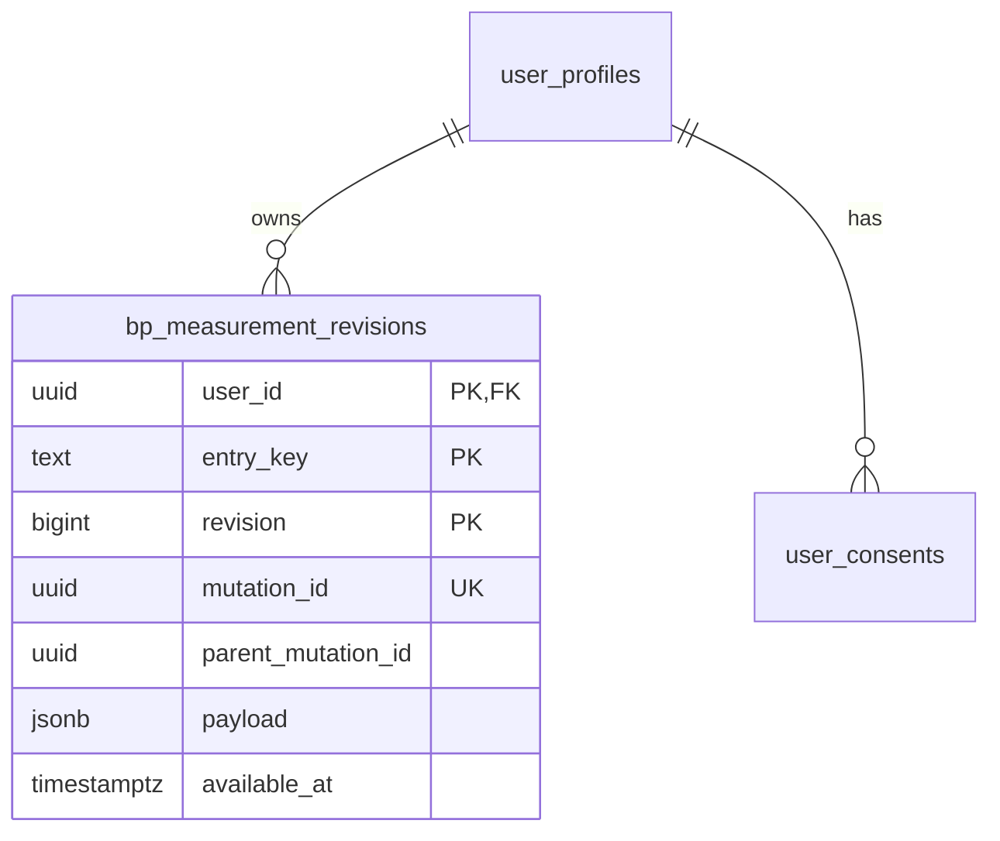

# 혈압 측정 이력 수집 구현

2026년 11월 2일 · `feature/dashboard-htn-sensitivity`

기존 건강 서베이를 유지하면서 **측정 정보와 불변 수정 이력**을 수집한다. 기기 내 대기 이력과 서버가 접수한 이력을 구분하고, 예측 연구 모듈에는 서버가 확인한 이력만 변환한다. 운영 DB 마이그레이션·APK·OTA 배포는 이번 작업 범위에 포함하지 않았다.

## 사용자 입력

아침·저녁 측정값 아래의 ‘측정 정보’는 선택 입력이다. 실제 시각을 아는 경우 픽셀 시간 선택기로 입력하고, 장소·혈압계 종류·기기 구분 이름·측정 자세 확인 여부를 선택한다. 모르는 항목은 미확인으로 남겨도 서베이를 제출할 수 있다. 현재 시각이나 휴대폰 ID로 혈압계 정보를 자동 생성하지 않는다.

시각은 한국 표준시의 해당 기록 날짜에 속해야 하고 제출 시각 이후일 수 없다. 정밀도는 `minute` 또는 `day`로 남긴다. 값만 존재하는 이전 설문에는 시각·기기·측정 환경을 추정해서 추가하지 않는다. 사용자 확인은 임상 검증된 기기 인증이나 의료진 확인을 의미하지 않는다.

보상 조건은 기존과 같다. 혈압 수치나 추가 정보의 응답 여부로 EXP를 차등 지급하지 않고, 같은 날 수정으로 퀘스트 보상을 중복 지급하지 않는다.

### 요구사항 변경분

| 요구사항              | 완료 조건                                                               |
| --------------------- | ----------------------------------------------------------------------- |
| 측정 정보는 선택 입력 | 미확인으로 제출 가능. 실제 시각·장소·혈압계·자세만 기록                 |
| 정정 원본 보존        | 수정·미측정을 새 개정으로 추가. 원본 UPDATE·DELETE 불허                 |
| 계정과 동의 격리      | 본인 JWT와 유효한 저장 동의로만 조회·추가. 전환 중 응답 무시            |
| 과거 재현             | 서버 수신 시각을 먼저 제한한 뒤 최신 개정을 선택                        |
| 안전한 실패           | 오프라인·중복 재전송·충돌·저장 공간 부족 시 기록을 조용히 유실하지 않음 |
| 보상과 분석 분리      | 입력 혈압의 정상 여부·부가 정보가 퀘스트 보상 조건이 아님               |

## 기기 내 이력과 서버 이력

| 항목             | 기기 대기 이력                                         | 서버 접수 이력                                      |
| ---------------- | ------------------------------------------------------ | --------------------------------------------------- |
| 소유자           | 현재 로그인 계정별 저장 키. 익명·데모·실제 계정을 분리 | JWT의 `auth.uid()`에서 결정                         |
| 측정 키          | `survey:날짜:morning/evening`                          | 같은 논리 키로 개정을 직렬화                        |
| 변경 식별        | 새 `mutation_id`, 직전 변경의 `parent_mutation_id`     | 같은 ID 재전송은 동일 응답. 다른 본문 재사용은 거절 |
| 개정 번호        | null                                                   | 서버가 1부터 부여                                   |
| 이용 가능 시각   | `available_at=null`                                    | 서버 `clock_timestamp()`로 부여                     |
| 삭제·미측정 정정 | 기존 값을 지우지 않고 삭제 개정 추가                   | 기존 개정을 보존하고 새 tombstone 추가              |

기기 저장 공간 부족 시 변경을 조용히 버리지 않는다. 읽을 수 없는 기존 이력은 덮어쓰지 않고 새 제출을 차단한다. 서버 미연결·미지원·네트워크 오류·충돌 시 대기 기록은 기기에 남긴다. 충돌하는 변경을 서버 최신값 위로 자동 재배치하지 않는다.

동기화는 기존 게임 `/v1/sync`와 별도다. 측정 이력 기능이 아직 배포되지 않은 서버에서도 게임·설문 저장 경로를 막지 않고 측정 이력 업로드만 대기한다. 수신 응답의 ID·개정·시각을 검증한 뒤에만 대기 상태를 해제한다. 계정 전환 시 진행 중 요청을 취소하고 다른 계정의 응답을 반영하지 않는다. 요청의 JWT도 해당 소유자에게서 읽은 토큰으로 고정한다.

이전 설문 가져오기는 아직 이력에 없는 슬롯만 대상으로 한다. 원래 측정 날짜는 보존하지만 최초 서버 수신 시각은 가져오는 시점이다. 서버에서 이미 정정·미측정 처리한 값을 오래된 게임 스냅샷으로 되살리지 않는다.

서베이를 새로 열 때는 게임 호환 스냅샷보다 최신인 측정 이력의 값·삭제 상태를 우선 표시한다. 열어 둔 동안 다른 변경이 들어오면 이전 초안을 새 이력 위에 저장하지 않고 다시 열어 확인하도록 안내한다. 같은 폼에서 저장 후 다시 수정하는 경우에는 자신의 새 개정을 기준으로 연결한다.

## 서버 계약

로컬 마이그레이션: `supabase/migrations/20261102132052_bp_measurement_revision_journal.sql`.

`public.bp_measurement_revisions`는 계정·논리 키·개정 번호를 기본 키로 사용한다. 앱에는 조회와 입력에 필요한 일부 열의 INSERT만 허용한다. `user_id`, `revision`, `available_at`을 앱이 직접 지정할 수 없다. UPDATE·DELETE 권한을 부여하지 않으며 계정 삭제의 FK cascade는 유지한다. 업무상의 정정 삭제와 개인정보의 실제 파기는 별도 개념이다.

모든 함수는 `SECURITY INVOKER`이며 노출 테이블에 RLS를 적용한다. JWT 소유자와 유효한 건강 정보 저장 동의를 확인한다. 서버가 정의하지 않은 필드·단위·시간대·JSON null 상태·잘못된 혈압 쌍은 거절한다. 같은 사용자의 프로필 행을 잠근 뒤 부모 변경 ID를 비교하므로 서로 다른 변경이 같은 다음 개정을 조용히 차지하지 못한다.

### ERD 변경분



`mutation_id`의 유일성 범위는 `(user_id, mutation_id)`다. 부모 ID는 같은 계정·논리 키의 직전 개정과 트리거로 대조한다. 동의는 소유 관계와 별도로 RLS/RPC가 확인한다. 기존 날짜별 게임 설문은 호환 스냅샷이며 이 테이블의 FK 부모가 아니다.

### API 변경분

| RPC                 | 입력                                                | 응답                                                                     |
| ------------------- | --------------------------------------------------- | ------------------------------------------------------------------------ |
| `append_bp_history` | `p_commands`: 최대 50개, 각 변경의 키·ID·부모 ID·값 | `contract=bp-history-v1`, 변경별 개정 번호·서버 수신 시각                |
| `bp_history_heads`  | `p_after_key`, `p_limit` 1~200                      | 논리 키순 최신 개정 페이지                                               |
| `bp_history_at`     | `p_as_of`, `p_start`, `p_end`                       | 해당 시점까지 서버가 접수한 개정 중 키별 최신 상태. 최대 367개 날짜 범위 |

모두 `POST /rest/v1/rpc/{함수명}`이며 JSON 본문, `apikey` 공개 키, `Authorization: Bearer {사용자 JWT}`를 사용한다. 입력 변경은 `mutation_id`, `entry_key`, `parent_mutation_id`, `value`만 허용한다. `value`에는 `recorded_on`, `slot`, `status`, `systolic`, `diastolic`, `unit`, `source`, `metadata`가 들어간다. 서버 지정 `user_id`, `revision`, `available_at`은 입력 계약에 포함하지 않는다. 수정이 충돌하면 `BP_MUTATION_CONFLICT`, 다른 본문으로 ID를 재사용하면 `BP_MUTATION_ID_REUSE`, 동의가 없으면 `BP_CONSENT_REQUIRED`를 반환한다.

RPC 호출은 기존 Supabase 인증과 공개 클라이언트 키를 사용한다. 관리자 키나 새로운 AWS 라우트는 추가하지 않았다. 동의 철회 후에는 클라이언트 업로드를 중단하며, DB의 해당 동의가 철회된 경우 RLS와 RPC가 조회·추가를 거절한다. 모델 학습 동의를 건강 정보 저장 동의로 대신하지 않는다.

`bp_history_heads`는 동기화용이며 전체 개정 내보내기가 아니다. 예측 학습·과거 재현을 위한 자료는 별도로 승인된 서버 경로에서 전체 개정을 읽어야 한다. 일반 앱에 다른 사용자의 연구 자료 조회 권한을 부여하지 않았다.

## 예측 연구로의 변환

`ai/bp_forecast/rexrun_journal.py`는 계정별 전체 서버 개정 내보내기를 읽는 순수 변환기다. 자체 네트워크 조회나 실제 환자 자료 수집을 실행하지 않는다.

- 서버 개정 번호·수신 시각이 없는 기기 대기 자료는 거절한다.
- 원래의 관측 시각과 서버 이용 가능 시각을 분리한다.
- 날짜만 아는 자료의 관측 시각은 null로 남긴다.
- 혈압계 이름은 가명 주체와 결합해 연구용 구분 해시로 변환한다.
- 중간 개정이 빠진 최신 헤드 내보내기를 과거 전체 이력처럼 사용하지 않는다.
- 원래 개정·정정·삭제를 같은 이벤트의 버전으로 유지한다.

기록량·기기·시각이 부족하면 기존 예측 프로토타입의 보류 경로를 따른다. 이 수집 기능으로 실제 미래 예측 모델의 성능이나 오탐 감소가 검증되는 것은 아니다.

## 검증과 재현

프런트엔드는 잠금 파일로 `npm ci` 후 단위·브라우저·린트·서식·빌드 검사를 수행한다. 새 브라우저 검사는 선택 정보 입력, 수정·삭제 개정 보존, 새로고침, 보상 중복 방지, 320~430px 레이아웃을 다룬다.

SQL은 PGlite 0.5.14의 격리된 PostgreSQL에서 기존 마이그레이션을 포함해 검증한다. 익명 접근·타 계정 접근·동의 철회·서버 필드 위조·원본 수정·삭제·중복 ID·원자적 롤백·과거 시점 복원·페이지 조회를 검사한다. 실제 Supabase 프로젝트나 환자 데이터는 사용하지 않는다. PGlite는 단일 연결이므로 실제 다중 연결 경합·PostgREST·호스팅 프로젝트의 advisors 검사를 대신하지 않는다.

```powershell
npm install --prefix .cache/bp-journal-tools --package-lock=false --no-save @electric-sql/pglite@0.5.14
node supabase/tests/bp-journal.mjs
python -m unittest discover -s ai/bp_forecast/tests -v
```

브라우저가 만든 합성 변경을 SQL에 넣고, 서버 응답을 예측 입력으로 변환하는 연결 검사도 지원한다. 아래 파일은 검증 중 생성되는 Git 제외 자료다.

```powershell
# frontend에서 REXRUN_BP_CAPTURE를 ../.cache/bp-journal-capture 절대 경로로 두고
# tests/blood-pressure-history.spec.ts를 실행한 뒤 저장소 루트에서 실행한다.
$env:REXRUN_BP_COMMANDS = (Resolve-Path .cache/bp-journal-capture/commands.private.json).Path
$env:REXRUN_BP_SERVER_EXPORT = Join-Path (Resolve-Path .cache/bp-journal-capture).Path 'server-revisions.private.json'
node supabase/tests/bp-journal.mjs
python -m ai.bp_forecast.verify_collection --input .cache/bp-journal-capture/server-revisions.private.json
```

이 연결 검사는 합성 자료임이 표시된 파일만 허용한다. 당일 아침·저녁 값과 수정 이력 3개가 서버 시각을 받아 변환됐고, 관측이 하루뿐이므로 미래 예측은 보류됐다.

### 이번 실행 결과

| 검증                  | 결과                                                                                                                         |
| --------------------- | ---------------------------------------------------------------------------------------------------------------------------- |
| 프런트 단위 테스트    | 60개 파일, 364개 통과 (`npm test -- --maxWorkers=2`)                                                                         |
| 프런트 정적 검사      | 전체 lint·format 및 타입/프로덕션 빌드 통과                                                                                  |
| 관련 브라우저 회귀    | 38개 통과. 이전 대시보드 문구를 찾던 1개는 현행 측정 분석·Sub Quest 경로에서 같은 응답·보상 조건을 검사하도록 수정 후 재실행 |
| SQL·권한·시간 이력    | 47개 검사 + 합성 브라우저 자료 연결 1개 통과                                                                                 |
| 예측 연구 단위 테스트 | 30개 통과                                                                                                                    |
| 기존 동결 근거 보존   | 응답 계약 19개, 게시된 집계 일치 확인                                                                                        |

단위 검사 첫 병렬 실행에서 기존 식단 자료 로딩 1개가 5초 제한을 넘겼다. 테스트 제한과 구현은 바꾸지 않고 워커 2개로 전체를 다시 실행해 364개가 통과했다. Windows 샌드박스가 기존 Worker 파일의 `realpath`를 차단한 빌드는 동일 명령을 일반 로컬 권한으로 재실행해 통과했다. 생성 빌드와 브라우저 자료는 Git에 추가하지 않는다.

## 운영 반영 조건

서버 마이그레이션을 스테이징 Supabase에 먼저 적용하고 실제 다중 연결·PostgREST·권한 점검을 마친 뒤 앱을 배포한다. 같은 순서로 운영에 반영해야 서버 저장 완료 상태가 표시된다. 현재 사용자에게 필요한 새 자격 증명이나 원자료 파일은 없다. 실제 기기·환경·시각은 사용자가 입력할 때부터 확보되며, 실제 종단 학습 코호트는 이 기록이 쌓인 뒤 별도 동의·가명화·평가 절차로 준비한다.
