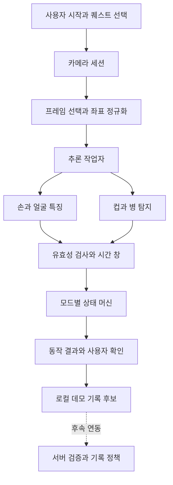

# REXRUN 물 마시기와 약 복용 모션 인식 설계 명세서

휴대폰 전면 카메라에서 손과 입의 위치, 컵과 병의 위치, 시간에 따른 움직임을 분석해 건강 행동의 기록을 돕는다. 1차 구현은 기기 안에서 실행하는 안내형 데모로 만들고, 수집한 평가 데이터에 따라 동작 분류 모델을 추가한다. 인식 결과는 동작을 관찰한 결과이며 실제 삼킴이나 복약 이행을 보증하는 결과로 사용하지 않는다.

| 항목        | 기준                                                           |
| ----------- | -------------------------------------------------------------- |
| 문서 버전   | 0.4 픽셀 카메라 통합과 디자인 보존                            |
| 작성일      | 2026년 10월 6일 KST                                            |
| 작업 브랜치 | `feature/pixel-adventure-device-quests`                       |
| 통합 기준   | 픽셀 브랜치 `67a021b`, 모션 원본 `d5c1ce4`                   |
| 1차 대상    | React 모바일 웹, 물 마시기와 약 복용 모션                      |
| 후속 대상   | Capacitor Android와 iOS 실기기, 학습 기반 분류, 서버 기록 검증 |

## 1 목표와 인식 범위

사용자가 퀘스트를 선택하고 카메라를 켜면 촬영 자세를 안내한다. 연속된 프레임에서 동작의 시작과 끝을 관찰한 뒤 결과를 보여주고, 사용자가 확인하면 해당 세션의 기록 후보를 확정한다. 화면은 기존 Figma 자산과 앱의 공통 레이아웃을 따른다.

| 항목         | 1차 구현                                                      | 범위 밖                                                        |
| ------------ | ------------------------------------------------------------- | -------------------------------------------------------------- |
| 물 마시기    | 컵이나 병을 입 근처로 가져갔다가 내려오는 동작 감지           | 내용물이 물인지 판별, 마신 부피 측정, 한 모션을 한 잔으로 환산 |
| 약 복용 모션 | 준비 확인 후 손가락을 입 근처로 가져갔다가 내려오는 동작 감지 | 약 이름과 용량 식별, 실제 삼킴 확인, 복약 이행 보증            |
| 처리 위치    | 카메라 프레임의 온디바이스 추론                               | 기본 촬영 영상의 서버 업로드                                   |
| 결과 활용    | 사용자 확인을 포함한 로컬 데모 결과                           | 실제 인증 영수증 발급과 직접 보상 지급                         |
| 촬영 방식    | 사용자가 시작하는 짧은 세션, 컵 또는 병을 사용하는 동작       | 백그라운드 감시, 빨대 사용, 얼굴이 보이지 않는 촬영            |

약 복용 모션은 사용자가 이미 계획한 행동을 촬영하는 흐름으로 제공한다. 인식 실패 시 다시 약을 먹도록 안내하지 않고, 촬영 재시도 또는 수동 기록으로 안내한다. 테스트에서 같은 동작을 반복할 때도 실제 약을 반복 복용하지 않는다.

## 2 저장소 기준과 통합 의존성

초기 모션 구현은 `develop`에서 분기한 `feature/motion-capture-parts`에서 진행했다. 현재 통합 대상은 React, TypeScript, Vite, Zustand 기반 `feature/pixel-adventure-device-quests`이며, 기존 `/camera` 경로와 사진 모드에 MediaPipe 및 모션 판정을 연결한다. `useGameStore.complete()`와 `repeat()`는 퀘스트 실천·데모 보상을 변경하므로 모션 감지 콜백에서 직접 호출하지 않는다. [현재 게임 도메인](../frontend/src/domain/game.ts), [게임 저장소](../frontend/src/stores/game-store.ts), [라우터](../frontend/src/App.tsx)

통합 기준 `67a021b`의 픽셀 디자인, 게임·걸음 수 연동, 기존 `CameraPage`, Capacitor 설정을 유지한다. 모션 원본 `d5c1ce4`에서 인식·추적·세션 모듈과 모델 준비 스크립트만 옮긴다. 원본 모션 화면과 CSS는 가져오지 않는다. 네이티브 앱의 실제 카메라·추론 지원은 이번 브라우저 검증에 포함하지 않는다.

기존 사진 촬영과 새 인식의 스트림 소유권을 분리하고, 퀘스트 변경·사진 촬영·화면 이탈 시 해당 세션을 종료한다. 현재 구현·검증 범위와 디자인 보존 원칙은 13·14절에 기록한다. 브랜치 운용과 병합은 [Git Flow](GIT_FLOW.md)를 따른다.

## 3 모델 선택

다음 표는 구현 단계별 설계 선택이다. 실행 속도와 동작 정확도는 지정한 휴대폰에서 측정해 확정한다.

| 구성                           | 역할                                           | 단계           | 학습과 선택 근거                                                                                                                                                                                                    |
| ------------------------------ | ---------------------------------------------- | -------------- | ------------------------------------------------------------------------------------------------------------------------------------------------------------------------------------------------------------------- |
| MediaPipe Hand Landmarker      | 손 관절 21개, 손가락 자세와 이동 추적          | 1차 필수       | 사전학습 번들을 사용한다. 한 사람이 사용하는 최대 두 손을 추적한다. [공식 문서](https://developers.google.com/edge/mediapipe/solutions/vision/hand_landmarker)                                                      |
| MediaPipe Face Landmarker      | 입 중심, 얼굴 크기, 얼굴 방향 추정             | 1차 필수       | 사전학습 번들을 사용한다. 단일 얼굴을 대상으로 하고 불필요한 표정 출력은 끈다. [공식 문서](https://developers.google.com/edge/mediapipe/solutions/vision/face_landmarker)                                           |
| EfficientDet-Lite0             | 컵과 병의 위치 탐지                            | 1차 필수       | 320 × 320 입력 모델을 기준으로 float16과 int8 실행을 비교한다. COCO 사전학습 모델은 알약이나 약 포장 전용 모델이 아니다. [공식 문서](https://developers.google.com/edge/mediapipe/solutions/vision/object_detector) |
| 규칙 기반 상태 머신            | 접근, 입 근처 유지, 내려오기 순서 판정         | 1차 필수       | 학습 모델이 아닌 시간 기반 로직이다. 초기 동작 확인과 데이터 수집의 기준선으로 사용한다.                                                                                                                            |
| 소형 TCN                       | 좌표와 객체 특징의 시계열을 입력받아 행동 분류 | 2차 우선 후보  | 서비스 촬영 데이터로 학습한다. LSTM을 비교 기준으로 두고 지연과 혼동률에 따라 선택한다. [TCN 논문](https://arxiv.org/abs/1803.01271)                                                                                |
| YOLO26n                        | 컵, 병, 알약, 약 포장 등의 객체 탐지           | 2차 대체 후보  | 약 전용 라벨로 추가 학습한다. EfficientDet와 비교해 하나를 선택한다. 모바일 내보내기와 배포 라이선스를 구현 시 확정한다. [공식 문서](https://docs.ultralytics.com/models/yolo26/)                                   |
| MoViNet-A0                     | RGB 영상의 시간적 변화로 행동 분류             | 후속 비교 후보 | 좌표 방식으로 해결하기 어려운 혼동이 남을 때 평가한다. 자체 데이터로 미세 조정하고 모바일 실행 비용을 측정한다. [공식 튜토리얼](https://www.tensorflow.org/hub/tutorials/movinet)                                   |
| MediaPipe Pose Landmarker Lite | 어깨, 팔꿈치, 손목 등 상반신 움직임 보강       | 선택 사항      | 기본 파이프라인에서 제외하고, 상반신 특징이 실제 성능을 개선할 때 추가한다. [공식 문서](https://developers.google.com/edge/mediapipe/solutions/vision/pose_landmarker)                                              |

MediaPipe Gesture Recognizer의 기본 분류는 주먹, 손바닥, 엄지 등 손 모양을 대상으로 한다. 이 기본 모델을 물 마시기나 복약 행동 분류기로 사용하지 않는다. [공식 문서](https://developers.google.com/edge/mediapipe/solutions/vision/gesture_recognizer)

`@mediapipe/tasks-vision`은 구현 시 호환성을 확인한 정확한 버전으로 고정하고 `frontend/package-lock.json`을 갱신한다. JavaScript, WASM, 모델 파일의 버전을 함께 관리한다. 실행 중 `latest` URL을 참조하지 않고 같은 출처에서 모델과 WASM을 제공한다. 모델 목록에는 출처, 버전, SHA-256, 파일 크기, 라이선스, 입력 및 출력 형식과 전처리 설정을 기록한다.

## 4 사용자 촬영 흐름

| 순서        | 화면 동작                                                 | 완료 조건                                                                                          |
| ----------- | --------------------------------------------------------- | -------------------------------------------------------------------------------------------------- |
| 퀘스트 선택 | `/camera?quest=water` 또는 `/camera?quest=medicine` 진입  | 두 퀘스트만 모션 모드로 허용한다. `/camera?quest=meal`의 기존 식사 사진 모드를 유지한다.             |
| 시작        | 카메라와 모델 준비 상태를 표시하고 시작 버튼 제공         | 카메라 권한은 버튼을 누른 뒤 요청한다. 오디오를 요청하지 않는다.                                   |
| 구도 안내   | 휴대폰을 세워 두고 얼굴, 손과 컵을 함께 담도록 안내       | 얼굴 하나와 필요한 손이 안정적으로 보인다. 시작 전부터 입 근처에 있는 손은 완료로 처리하지 않는다. |
| 준비 확인   | 물은 컵 또는 병 탐지, 약은 약 준비 안내와 사용자 확인     | 약 준비 확인은 `user_ack`로 기록한다. 알약 자동 탐지로 표현하지 않는다.                            |
| 동작 관찰   | 입으로 가져가기, 잠깐 유지, 내려오기를 짧은 문장으로 안내 | 선택한 모드의 순서 조건을 충족한다.                                                                |
| 결과        | 감지된 동작과 사용자 확인 버튼 표시                       | 확인 또는 취소를 선택한다. 감지가 불충분하면 수동 기록 또는 촬영 재시도를 제공한다.                |
| 종료        | 카메라 종료 후 퀘스트 화면 복귀                           | 모든 스트림, 프레임 버퍼와 추론 자원을 정리한다.                                                   |

결과 문구는 물 모드에서 “마시는 동작을 감지했어요”, 약 모드에서 “손을 입으로 가져가는 동작을 감지했어요”로 한다. 약 모드에서는 준비 확인과 함께 “복용 모션 기록”으로 보여줄 수 있지만 “약을 삼켰어요”나 “복약 인증 완료”로 표시하지 않는다.

두 모드는 사용자가 먼저 선택한다. 1차 버전은 임의 영상에서 물과 약을 자동으로 구별하는 분류기가 아니다. 모델 로딩, 권한 거부, 구도 안내, 관찰 중, 결과 확인, 취소 상태를 구분하고 진행 안내는 색상과 애니메이션 외에 텍스트로도 전달한다.

## 5 처리 구조와 모듈 경계



아래 경로 중 `camera-session.ts`와 `frame-scheduler.ts`의 책임은 데모에서 `useMotionCapture.ts`에 함께 구현했다. 필요 시 독립 모듈로 분리한다.

| 예정 경로                                                  | 책임                                                       |
| ---------------------------------------------------------- | ---------------------------------------------------------- |
| `frontend/src/pages/CameraPage.tsx`                        | 퀘스트 선택, 상태 표시, 사용자 확인, 기존 사진 모드와 연결 |
| `frontend/src/features/motion-capture/types.ts`            | 세션, 프레임 특징, 결과, 오류와 설정의 타입                |
| `frontend/src/features/motion-capture/camera-session.ts`   | 권한, MediaStream, 시작과 종료, 비동기 요청 무효화         |
| `frontend/src/features/motion-capture/frame-scheduler.ts`  | 프레임 선택, 시간 정보, 추론 빈도와 자원 회수              |
| `frontend/src/features/motion-capture/inference.worker.ts` | 모델 로딩과 추론, 세션 ID 확인, 모델 자원 해제             |
| `frontend/src/features/motion-capture/features.ts`         | 손과 입 거리, 손 자세, 객체 관계, 시간 특징 추출           |
| `frontend/src/features/motion-capture/detector.ts`         | 화면과 모델 API에 의존하지 않는 상태 머신                  |
| `frontend/src/features/motion-capture/config.ts`           | 버전별 임계값과 시간 설정                                  |
| `frontend/src/features/motion-capture/useMotionCapture.ts` | React 생명주기와 각 모듈 연결                              |
| `frontend/public/models/motion-capture/manifest.json`      | 고정 모델 메타데이터와 체크섬                              |

일반 웹은 `getUserMedia()`로 라이브 스트림을 확보한다. 단일 사진만 반환하는 카메라 API는 모션 입력으로 사용하지 않는다. HTTPS 또는 localhost에서 실행하고 카메라 미지원, 권한 거부, 장치 없음, 다른 앱의 사용 중 상태를 구분한다. [카메라 API 문서](https://developer.mozilla.org/en-US/docs/Web/API/MediaDevices/getUserMedia)

MediaPipe Web의 연속 프레임 추론에는 `VIDEO` 모드를 사용한다. Web과 Android의 실행 모드 이름을 혼용하지 않는다. Web 추론 호출은 동기적으로 UI 스레드를 막을 수 있으므로 Worker 실행을 우선 검증한다. [MediaPipe Web 문서](https://developers.google.com/edge/mediapipe/solutions/vision/hand_landmarker/web_js)

Worker, 프레임 전달 형식, WASM과 GPU delegate의 조합은 브라우저별 기술 검증으로 결정한다. GPU가 실패하면 Worker CPU 경로를 시험하고, Worker 자체가 불가능하면 빈도를 제한한 메인 스레드 경로를 성능 기준 내에서만 허용한다. 어느 경로도 기준을 충족하지 못하면 자동 감지를 끄고 수동 기록을 제공한다. Capacitor WebView는 Android와 iOS에서 각각 검증한 뒤 지원 대상으로 선언한다.

## 6 프레임 처리와 특징 정의

### 스케줄링과 추적

가능하면 `requestVideoFrameCallback()`으로 새 프레임을 선택한다. 미지원 환경에서는 `requestAnimationFrame()`과 `video.currentTime` 변화로 중복 프레임을 건너뛴다. 손과 얼굴은 동일한 프레임에서 분석하고 객체 탐지는 낮은 빈도로 실행하되 결과에 프레임 시각을 붙인다. [프레임 콜백 문서](https://developer.mozilla.org/en-US/docs/Web/API/HTMLVideoElement/requestVideoFrameCallback)

진행 중인 추론은 최대 하나, 대기 프레임은 최신 하나만 둔다. 밀린 영상을 나중에 처리하는 무제한 큐를 만들지 않는다. 객체 결과가 오래되거나 추적 연결이 끊기면 이전 위치를 현재 객체로 간주하지 않는다. 프레임 및 모델 메시지에는 `sessionId`를 넣어 종료된 세션의 결과를 폐기한다.

얼굴 하나를 대상으로 한다. 두 얼굴 이상이 발견되면 판정을 보류한다. 얼굴 설정에서 최대 얼굴 수를 하나로 잘라 두면 두 번째 사람을 알 수 없으므로 구도 검사에서 최소 두 얼굴까지 확인하는 방식을 기술 검증한다. 손은 연속 위치와 얼굴과의 관계로 연결하고 좌우 손 라벨만으로 동일 손을 보장하지 않는다. 얼굴이나 동작 대상 손이 바뀌면 진행 중인 후보를 초기화한다.

### 좌표와 입력 특징

추론에는 미러링하지 않은 원본 방향의 프레임을 사용한다. 전면 카메라 미리보기만 좌우 반전할 수 있으며 안내선과 객체 박스는 동일 변환을 적용한다. 추론 영역은 미리보기의 세로 크롭 영역과 일치시키거나, 원본에서 화면까지의 변환 행렬로 화면 밖 대상을 제외한다.

약 모드의 손과 입 거리는 같은 프레임의 픽셀 좌표로 계산하고 얼굴 너비로 나눈다. 물 모드는 입에서 컵·병 박스까지의 최단 픽셀 거리를 얼굴 너비로 나눈다. 큰 컵의 아래쪽을 잡으면 손바닥이 입에서 멀어도 컵은 입에 닿을 수 있으므로 물 모드에 손·입 거리 조건을 함께 요구하지 않는다. 너비와 높이에 각각 정규화된 x와 y를 그대로 유클리드 거리로 합치지 않는다.

```text
distanceToMouth = sqrt(((handX - mouthX) * frameWidth)^2
                    + ((handY - mouthY) * frameHeight)^2) / faceWidthPx
```

서로 다른 모델의 z 또는 world 좌표는 원점과 척도가 다를 수 있으므로 그대로 빼서 손과 입의 3D 거리를 계산하지 않는다. 1차 판정은 같은 이미지의 2D 관계를 기준으로 한다.

| 특징           | 정의와 용도                                                                                                                 |
| -------------- | --------------------------------------------------------------------------------------------------------------------------- |
| 입 중심        | 입술 좌표의 중심. 가림이나 추적 불안정 시 해당 프레임을 무효화한다.                                                         |
| 손 접근점      | 물 모드는 손바닥 중심, 약 모드는 엄지와 검지 끝의 중점                                                                      |
| 접근과 복귀    | 입과의 거리 감소 및 증가, 시간당 변화량, 동작 시작 위치                                                                     |
| 손가락 자세    | 엄지와 검지 거리 및 관절 각도. 약을 집은 자세의 보조 특징이며 약 존재의 증거는 아니다.                                      |
| 객체 관계      | 입·손 접근점에서 컵이나 병의 박스까지의 최단 픽셀 거리를 얼굴 너비로 정규화한다. 같은 객체가 손과 함께 움직이는지 확인한다. |
| 객체 신선도    | 마지막 객체 관찰과 현재 프레임의 시간 차                                                                                    |
| 유효 관찰 비율 | 최근 시간 창에서 판정에 필요한 관찰이 유효한 비율                                                                           |
| 관찰 끊김      | 얼굴, 손 또는 필요한 객체를 확인하지 못한 연속 시간                                                                         |

객체 탐지 박스만으로 컵의 정확한 테두리나 기울기를 알 수 있다고 가정하지 않는다. 1차에서는 접근, 유지, 복귀와 객체 관계를 사용하고, 기울기 특징은 추가 모델 또는 검증된 기하 추정이 생길 때 도입한다.

## 7 동작 상태와 판정 조건

카메라 세션 상태와 동작 상태를 분리한다. 세션은 `idle → loading → framing → observing → result → closed`를 따르며 오류와 취소는 어느 단계에서든 종료로 이어질 수 있다. 동작 상태는 유효 프레임과 단조 증가 시각만으로 전이한다.

### 물 마시기

```text
ready → object_ready → approaching → at_mouth → returning → detected
```

1. 얼굴과 컵 또는 병, 연관된 손이 보이고 객체가 입에서 떨어져 있는 기준 위치를 확보한다.
2. 같은 손과 객체가 입 쪽으로 이동하는 것을 연속 관찰한다.
3. 객체 박스가 입 주변에 있고 손이 해당 객체와 연결되는 조건을 일정 시간 유지한다.
4. 같은 손과 객체가 입에서 멀어지고 컵·병이 다시 모델에 탐지되는 복귀 동작을 확인한다.
5. 순서와 관찰 품질을 모두 충족하면 `drinking_motion`을 한 번 생성한다.

영상 시작부터 컵이 입에 붙어 있거나, 손만 얼굴에 접근하거나, 컵을 얼굴 앞에서 옆으로 지나가게 하는 동작은 완료로 처리하지 않는다. 탐지되지 않는 투명 컵, 빨대, 극심한 가림은 수동 기록 대상으로 안내한다.

### 약 복용 모션

```text
ready → preparation_acknowledged → approaching → at_mouth → returning → detected
```

1. 사용자가 약을 준비했음을 확인한다. 준비 화면에서 약을 보여주도록 안내하되 기본 탐지 모델이 이를 검증했다고 표시하지 않는다.
2. 입에서 떨어진 시작 위치와 손가락 접근점을 확보한다.
3. 같은 손가락 접근점이 입 주변에 도달하고 잠깐 유지하는 것을 관찰한다.
4. 같은 손이 내려오거나 입에서 멀어지면 `hand_to_mouth_motion`을 생성한다.
5. 실제 복용 여부는 사용자가 확인한다. 이후 물 마시기는 선택적 보조 신호이며 복약 모션 완료의 필수 조건으로 두지 않는다.

준비 확인이 없는 손 접근은 약 복용 모션으로 연결하지 않는다. 얼굴 만지기나 음식 먹기와의 혼동이 남으므로 1차 결과의 검증 수준은 항상 `local_demo`다. 2차에는 학습한 약 객체 탐지와 시간 분류를 추가해 준비와 동작의 연결을 개선한다.

### 초기 설정과 무효화

아래 값은 구현을 시작하기 위한 초기 설정이며 측정된 정확도나 제품 보장값이 아니다. 개발용 조정은 가능하지만 배포 설정은 버전과 함께 고정한다.

| 설정                   | 초기값                         | 적용 방법                                                                                        |
| ---------------------- | ------------------------------ | ------------------------------------------------------------------------------------------------ |
| 손·얼굴 추론 목표      | 10 Hz                          | 관찰 시각 기준으로 처리하고 프레임 수로 시간을 대체하지 않는다.                                  |
| 객체 탐지 목표         | 5 Hz                           | 최신 유효 객체 결과만 사용한다.                                                                  |
| 좌표 추출용 프레임     | 최대 640 × 480, 원본 비율 유지 | 모델별 입력 전처리는 별도로 적용한다.                                                            |
| 특징 시간 창           | 3초, 100 ms 슬롯 최대 30개     | 부족하거나 오래된 항목은 제거한다.                                                               |
| 객체 탐지 점수         | 첫 확인 0.4, 연속 추적 0.25    | 낮은 점수는 이전 객체와 위치·크기·종류가 이어질 때만 허용한다. 객체 점수는 동작 확률이 아니다.   |
| 손 탐지·존재·추적 설정 | 각각 0.5                       | 모델의 추적 설정과 특징의 유효 여부를 구분한다.                                                  |
| 입 근처 진입           | 물 0.4 이하, 약 0.6 이하       | 물은 입에서 객체 박스까지, 약은 손 접근점에서 입까지의 정규화 거리에 적용한다.                   |
| 입 근처 이탈           | 물 0.8 이상, 약 1.0 이상       | 진입·이탈 기준을 다르게 두어 경계 흔들림을 줄인다.                                               |
| 물 객체와 입의 거리    | 박스까지 정규화 거리 0.4 이하  | 큰 컵을 잡은 손 자체가 입에서 멀어도 허용한다.                                                   |
| 물 객체와 손의 거리    | 박스까지 정규화 거리 0.5 이하  | 같은 손과 객체의 연결 조건으로 사용한다.                                                         |
| 안정적인 시작·복귀     | 각각 300 ms                    | 후보 시작과 완료에 적용한다.                                                                     |
| 입 근처 유지           | 물 700 ms, 약 모션 250 ms      | 관찰이 유효한 시간만 누적한다.                                                                   |
| 시간 누적용 관찰 간격  | 최대 250 ms                    | 같은 조건을 만족하는 인접 관찰 사이의 간격만 누적한다. 초과 간격은 유지 시간에 포함하지 않는다.  |
| 객체 결과 최대 나이    | 직접 결과 500 ms, 보완 1500 ms | 보완에는 현재 얼굴·손과 기존 컵 연결이 필요하다. 반복 보완으로 원래 탐지 시각을 갱신하지 않는다. |
| 연속 관찰 끊김 허용    | 물 최대 900 ms, 약 500 ms      | 얼굴·손이 끊긴 동안 시간을 누적하지 않고 초과하면 후보를 초기화한다.                             |
| 유효 관찰 비율         | 최근 3초 중 80% 이상           | 해당 모드의 필요한 관찰을 기준으로 계산한다.                                                     |
| 자동 관찰 제한         | 20초                           | 모델 로딩 시간은 제외하고 초과 시 수동 기록 또는 촬영 재시도를 안내한다.                         |

유효 관찰 비율은 최근 3초를 100 ms 슬롯으로 나눠, 각 슬롯에서 마지막으로 확인한 관찰이 유효한 슬롯의 비율로 계산한다. 관찰이 없는 슬롯은 무효로 세고 세션 시작 후 3초가 지나기 전에는 실제 경과한 슬롯만 사용한다. 처리한 프레임 수가 줄었다는 이유로 관찰 비율이 높아지지 않아야 한다.

입 주변에서 컵 탐지 점수가 떨어지거나 탐지가 빠지면, 현재 얼굴과 같은 손이 보이는 경우에만 마지막으로 확인한 컵 박스를 손 이동량만큼 옮겨 최대 1.5초 연결한다. 이 구간은 `objectEvidence: tracked`, `objectOccluded: true`로 구분하며 원래 `objectObservedAt`을 갱신하지 않는다. 모델 추론 사이의 예약 간격은 가림으로 표시하지 않는다. 가림 구간에도 실제 손·얼굴 관찰이 이어질 때만 시간을 누적한다. 얼굴이나 손까지 사라지면 누적을 멈추고 모드별 끊김 한도를 넘으면 초기화한다.

가려진 컵의 추정 위치만으로 완료하지 않는다. 복귀 단계에서 같은 컵·병이 모델에 다시 탐지된 관찰이 있어야 결과를 생성한다. 추적 대상 교체, 박스 크기·위치 불연속, 오래된 컵, 세션 변경이나 앱의 비활성화에서는 후보를 버린다. 이 보완은 데모용 추적 규칙이며 실기기 오탐·미탐 평가로 임계값을 조정해야 한다.

최종 결과에 도달하면 카메라와 추론 자원을 즉시 종료하고 해당 세션을 잠근다. 사용자 확인 화면에는 결과 메타데이터만 유지하고 추가 이벤트를 생성하지 않는다. 다시 촬영하면 새 `sessionId`를 발급한다. 타이머만으로 같은 동작을 반복 완료시키지 않는다.

## 8 세션 결과와 기록 계약

아래 타입은 프런트엔드 모듈 간 계약 초안이다. 서버 API가 구현되었다는 의미는 아니다.

```ts
type MotionQuest = "water" | "medicine";
type MotionKind = "drinking_motion" | "hand_to_mouth_motion";

type MotionResult = {
  schemaVersion: 1;
  sessionId: string;
  eventId: string | null; // detected일 때만 발급
  inputSource: "camera" | "sample";
  questId: MotionQuest;
  kind: MotionKind | null; // inconclusive와 cancelled는 null
  decision: "detected" | "inconclusive" | "cancelled";
  detector: "rules_v1" | "tcn_v1";
  modelManifestVersion: string;
  configVersion: string;
  startedAt: string; // ISO 8601, 기록 표시용
  endedAt: string;
  durationMs: number; // 단조 증가 시각으로 계산
  validObservationRatio: number;
  classificationScore: number | null; // rules_v1은 null
  preparationSource: "not_required" | "user_ack" | "model_detection";
  verificationLevel: "local_demo";
  userConfirmed: boolean;
  reasonCodes: string[];
};
```

각 선택 모드에서 물은 `drinking_motion`, 약은 `hand_to_mouth_motion`만 허용한다. 1차 약 모드의 `preparationSource`는 `user_ack`이며, `model_detection`은 전용 객체 모델을 도입한 뒤에만 사용한다. 사용자 확인은 새로운 감지 이벤트를 만들지 않고 동일 `eventId`의 확인 상태만 바꾼다. 규칙 기반 결과에 임의의 “정확도 95%”를 붙이지 않는다.

시간 기반 판정에는 `performance.now()` 등 단조 증가 시각을 사용한다. 기기 시계가 바뀌어도 상태 전이의 경과 시간이 바뀌지 않아야 한다. 화면 표시용 날짜는 기존 게임 정책과 통합 시 결정하며, 운영 보상 판단은 서버 시각을 따른다.

1차 결과와 사용자 확인은 세션 메모리에만 유지하고 새로고침 뒤 복원하지 않는다. 영구 동작 기록 저장은 별도 동의와 데이터 정책을 포함하는 후속 범위다. 화면에서 수동 퀘스트 완료로 이동할 수 있지만 모션 감지 자체는 `complete()`를 호출하거나 기존 저장소·지갑을 변경하지 않는다.

현재 물 퀘스트는 “물 8잔”을 일일 완료로 표현한다. 한 번의 마시기 동작으로 이 퀘스트를 완료하거나 1잔 또는 200 mL를 자동 가산하지 않는다. 이후 수분 기록에는 사용자가 확인한 양이나 연결된 측정값이 필요하다. 복약 일정별 완료는 등록 일정이 생긴 뒤 연결한다.

운영 연동에서는 인증된 사용자, 세션 만료, 일정, 서버 시각, 멱등키와 공통 지급 원장을 검증하는 서버 정책이 필요하다. 클라이언트의 결과나 점수만으로 신뢰 가능한 인증 영수증이 되지 않는다. 재생 영상과 변조 요청에 대한 대응도 서버 연동 단계에서 정하고, 필요 시 기존 [백엔드 연결 계획](REXRUN_모바일앱_뼈대_구상안.md#백엔드-연결)의 분석 작업 경로를 활용한다.

## 9 오류 처리와 자원 관리

| 상황                            | 처리                                                           |
| ------------------------------- | -------------------------------------------------------------- |
| 권한 거부                       | 권한을 자동 반복 요청하지 않고 설정 안내와 수동 기록 제공      |
| 보안 문맥 또는 카메라 미지원    | 지원 환경 안내, 자동 감지 시작 차단                            |
| 모델 다운로드 실패              | 재시도와 수동 기록 제공, 후보 이벤트 생성 금지                 |
| 얼굴·손·컵 불충분               | 필요한 대상의 구도 안내, 보이지 않는 동안 상태 전이 보류       |
| 여러 얼굴 또는 추적 대상 교체   | 후보 초기화 후 한 사람 촬영 안내                               |
| 관찰 시간 초과                  | 불충분 결과, 수동 기록 또는 촬영 재시도 제공                   |
| 늦게 도착한 카메라 권한 응답    | 종료된 세션이면 새 스트림의 모든 트랙 즉시 종료                |
| 늦게 도착한 추론 결과           | `sessionId`가 현재 세션과 다르면 폐기                          |
| 페이지 숨김·화면 이탈·취소·종료 | 세션 무효화, 카메라 트랙과 콜백 종료, Worker 및 모델 자원 해제 |
| 돌아온 화면                     | 사용자가 다시 시작하기 전에는 카메라를 재개하지 않음           |
| Worker 또는 GPU 오류            | 검증된 대체 경로로 전환하며 실패하면 수동 기록 제공            |

카메라 초기화 요청을 기다리는 동안에도 취소가 가능해야 한다. 프레임으로 만든 `ImageBitmap` 등의 자원은 처리 또는 폐기 후 닫는다. 모델 준비와 카메라 연결은 취소 토큰으로 관리하고 React 개발 모드의 중복 초기화에서도 트랙이나 Worker가 남지 않게 한다.

## 10 데이터 보관과 학습 계획

기본 동작 모드에서는 원본 영상, 프레임 이미지와 랜드마크를 서버, localStorage, IndexedDB 또는 분석 로그에 저장하지 않는다. 최근 3초의 특징은 메모리 안에서만 유지하며 세션 종료 시 제거한다. 카메라 외 오디오·위치 권한을 요청하지 않는다.

모델 평가용 수집은 기본 촬영과 별도 동의를 받는 개발 모드로 분리한다. 동의에는 목적, 저장 위치, 접근자, 보존 기간과 삭제 방법을 구체적으로 제시한다. 원본 데이터와 사용자 자료는 Git에 넣지 않고 접근을 제한한 저장소에서 관리한다. 약 포장의 개인 식별 정보는 평가 데이터에서 제거한다.

2차 분류 라벨은 `drinking`, `pill_to_mouth`, `eating`, `face_touch`, `idle`, `other`를 출발점으로 한다. `pill_to_mouth`는 화면에서 확인 가능한 약을 입으로 가져가는 행동을 뜻하며 실제 삼킴 라벨과 구분한다. 평가용 약 모션은 실제 복용을 반복하지 않는 대체 소품과 연출로 수집하고, 실제 사용 환경과의 차이는 별도로 평가한다.

| 수집 항목      | 계획                                                                                          |
| -------------- | --------------------------------------------------------------------------------------------- |
| 초기 탐색 규모 | 20명 × 6개 라벨 × 10클립인 약 1,200클립을 출발 목표로 둔다. 품질과 실패 유형에 따라 조정한다. |
| 영상 조건      | 얼굴·손·객체가 보이는 3~8초 클립, 시작과 복귀 포함                                            |
| 다양성         | 좌우 손, 앉은 자세, 안경, 피부색, 조명, 촬영 거리, 컵과 병 종류, 기기별 차이                  |
| 혼동 사례      | 빈손 입 접근, 간식, 입 가리기, 얼굴 긁기, 컵을 들기만 하기, 물만 마시는 약 모드               |
| 주석           | 행동 라벨, 접근·입 근처·복귀 시각, 가림, 유효 구간과 불확실 여부                              |
| 데이터 분리    | 사람별 12명 학습·4명 검증·4명 테스트를 초기 기준으로 두고 같은 사람의 클립을 나누지 않는다.   |
| 누수 방지      | 같은 촬영의 인접 구간과 증강본은 같은 분할에 둔다. 미경험 기기·컵 조건도 별도 평가한다.       |
| 비교           | 규칙 기준선, 소형 TCN, LSTM을 같은 테스트셋으로 비교한다.                                     |

제시한 데이터 수는 성능 달성을 보장하는 최소 수량이 아니다. 혼동 사례의 오류가 줄어드는지 보고 수집을 추가한다. TCN은 관절 궤적, 거리, 객체 상태, 시간 차와 누락 마스크를 입력받고, 학습과 추론에서 같은 전처리·좌표 정규화·시간 기준을 사용한다. 테스트 데이터로 임계값을 조정하지 않는다.

## 11 검증과 인수 기준

다음 수치는 개발 목표이며 아직 측정된 결과가 아니다. 1차의 약 동작 평가는 손을 입으로 가져가는 감지 성능만 나타낸다. 실제 복약 판별 성능으로 발표하지 않는다.

### 기능 검증

| 시나리오                     | 인수 조건                                                    |
| ---------------------------- | ------------------------------------------------------------ |
| 물 동작 정상 순서            | 사용자 확인까지 도달하고 세션당 이벤트는 한 개               |
| 약 준비 확인 후 정상 순서    | `user_ack`와 `hand_to_mouth_motion`의 로컬 데모 결과 생성    |
| 약 준비 확인 없음            | 약 모드 결과 확정 금지                                       |
| 컵 없이 얼굴 만지기          | 물 동작 결과 생성 금지                                       |
| 입 근처 유지 없이 지나가기   | 감지 결과 생성 금지                                          |
| 시작부터 손이나 컵이 입 근처 | 시작·접근·복귀 순서 확보 전 감지 금지                        |
| 중간 가림과 프레임 지연      | 가림 시간을 유지 시간으로 채우지 않음, 임계 초과 시 초기화   |
| 종료 후 늦은 결과            | 화면과 기록에 반영되지 않음                                  |
| 취소·화면 이탈·백그라운드    | 카메라, 콜백, 버퍼, 추론 자원 종료                           |
| 모션 결과 확인               | 물 8잔 완료, 복약 일정 완료 또는 보상으로 자동 연결되지 않음 |
| 원본과 좌우 반전 미리보기    | 같은 동작 결과, 안내선·객체 박스 위치 일치                   |

순수 판정 모듈은 실제 시간 간격과 누락을 포함한 특징 시퀀스로 단위 검증한다. 브라우저 테스트는 권한·로딩·취소·늦은 응답·중복 이벤트와 사용자 확인 흐름을 검증한다. 실제 카메라와 모델의 판별력은 실기기 영상 평가로 확인한다. 모의 카메라 테스트를 실기기 정확도 검증으로 대체하지 않는다.

### 성능과 동작 평가

| 지표                          | 초기 목표                                           | 측정 기준                                                                   |
| ----------------------------- | --------------------------------------------------- | --------------------------------------------------------------------------- |
| 프레임 선택부터 특징 처리까지 | p95 250 ms 이하                                     | 선택한 프레임의 시각과 처리 완료 시각의 차, 각 기기에서 20초 세션 10회 이상 |
| 복귀 완료부터 결과 표시까지   | p95 500 ms 이하                                     | 상태 머신의 복귀 조건 만족 이후 UI 결과 표시까지                            |
| 유효 손·얼굴 관찰             | 초당 8회 이상                                       | 정상 구도에서 입력 지연과 누락을 함께 기록                                  |
| 마시기·입 접근 동작 감지      | 클래스별 이벤트 precision 90% 이상, recall 80% 이상 | 미경험 사람의 테스트셋, 사용자 확인 전 감지 결과로 평가                     |
| 혼동 동작의 오탐              | 음성 테스트 세션의 5% 이하                          | 얼굴 만지기·들기만 하기 등 20초 세션, 라벨별 결과도 보고                    |
| 반복 세션 자원                | 종료 후 열린 트랙 0개, 살아 있는 세션 작업자 0개    | 시작·취소·재시도 10회, 메모리 누적과 발열도 관찰                            |

동작 평가에서는 예측 종료 시각이 주석 종료 시각의 ±1초 이내인 같은 클래스 이벤트를 일대일로 매칭한다. 매칭되지 않은 예측은 오탐, 실제 이벤트는 미탐으로 센다. 중복 예측은 추가 오탐으로 처리하고 표본 수와 혼동 행렬을 함께 제시한다. 목표를 충족하지 못하면 자동 감지의 지원 조건을 좁히거나 수동 기록으로 전환한다.

최소 평가 환경은 Android 중급 기기와 iPhone 각 한 종류의 모바일 브라우저다. 첫 기술 검증에서 모델명, OS, 브라우저 버전, 실행 delegate와 모델 버전을 평가 표에 고정한다. 네이티브 통합 이후에는 Android WebView와 iOS WKWebView를 별도로 평가한다. 최초 모델 로딩 시간과 재시도, 발열과 UI 반응도 함께 기록하며 네이티브 지원 범위는 해당 결과로 정한다.

구현 시 `frontend`에서 잠금 파일 기준으로 `npm ci`를 사용한다. 변경에 맞는 검증을 진행하고 최종 통합에서는 `npm run lint`, `npm run format:check`, `npm test`, `npm run build`, `npm run test:e2e`를 실행한다.

## 12 구현 순서와 결정 시점

| 단계        | 결과물                                                | 다음 단계 조건                                                     |
| ----------- | ----------------------------------------------------- | ------------------------------------------------------------------ |
| 0 설계      | 이 명세와 모델·판정·결과 계약                         | 물 동작과 복약 모션의 표현 및 기록 범위가 명확함                   |
| 1 기술 검증 | 손·얼굴·객체 추론과 Worker 입력의 최소 실험           | 기기별 실행 경로, 고정 버전, 모델 로딩·프레임 지연 확보            |
| 2 판정 모듈 | 특징 추출, 물과 약 모드의 상태 머신, 오류와 단위 검증 | 정상·혼동·누락·늦은 결과 시나리오 검증                             |
| 3 화면 통합 | 카메라 기반 통합, 촬영 안내, 결과와 사용자 확인       | 기존 사진 모드와 수동 퀘스트 동작 회귀 없음, 실기기 세션 종료 검증 |
| 4 평가      | 미경험 사용자 데이터의 기준선 평가                    | 목표 충족 여부와 실패 조건 기록, 미달 기능의 지원 범위 조정        |
| 5 학습 모델 | TCN 비교, 필요 시 약 객체 모델                        | 기준선 대비 오류와 지연이 개선되고 동일 평가셋에서 검증            |
| 6 운영 기록 | 백엔드 기록·일정·중복 방지·보상 정책 연결             | 로컬 모션과 운영 인증을 구분하고 별도 서버 명세 및 검증 완료       |

단계 1에서 정확한 패키지·모델 버전, float16과 int8 선택, Worker 프레임 형식과 기기 목록을 확정한다. 단계 4에서 관찰 시간과 거리 임계값을 고정한다. 물 섭취량 입력, 복약 일정, 서버 영수증과 직접 보상은 해당 데이터 및 서버 기능이 준비되는 단계 6에서 설계한다. 정식 배포와 릴리스는 별도 요청 범위다.

## 13 현재 데모 구현과 실행

`/camera?quest=water`와 `/camera?quest=medicine`에서 두 모드를 사용할 수 있다. 퀘스트 상세의 기존 카메라 링크로 진입한다. 카메라가 없는 환경에서는 퀘스트 선택창의 샘플 시연을 선택하고 “샘플 동작 보기”로 약 5초간 합성 좌표를 재생해 동일한 상태 머신과 결과 확인 흐름을 체험한다. 샘플은 실제 촬영·AI 판별 결과와 구별해 표시하고 `inputSource: sample`로 유지한다. 약 모드의 준비 확인은 사용자 입력이며 약 객체를 탐지했다는 뜻이 아니다.

```powershell
cd frontend
npm ci
npm run dev
```

첫 `dev` 또는 `build` 실행에서 `motion:setup`이 공식 고정 URL의 모델 세 개를 내려받고 크기와 SHA-256을 검사한다. 모델 캐시는 약 18.8 MB다. 패키지의 WASM을 로컬 공개 경로에 복사하며 브라우저 실행 중 외부 CDN을 사용하지 않는다. 다운로드 파일과 WASM 복사본은 Git에서 제외한다. 캐시가 준비된 환경은 `npm run motion:setup -- --offline`으로 검증할 수 있다. 재배포 전 모델 파일의 배포 조건 확인은 별도 작업이며 현재 manifest에는 검토 상태를 명시한다.

데모는 `@mediapipe/tasks-vision` **1.0.1**, 공식 버전 1의 float16 손·얼굴·EfficientDet-Lite0 모델을 고정한다. `ImageBitmap`을 module Worker에 전달하고 CPU delegate로 `VIDEO` 추론을 실행한다. CPU 추론에도 이미지 입출력의 WebGL 문맥은 필요하다. 1.0.1의 WASM 모듈 로더가 첫 작업 생성 후 전역 factory를 비우므로 작업마다 고유 loader query를 사용해 재초기화한다. GPU delegate와 메인 스레드 대체 경로는 아직 추가하지 않았다.

프레임 선택은 `requestAnimationFrame()`과 `video.currentTime`으로 제한하며 처리 중 프레임을 큐에 쌓지 않는다. 결과·시간 초과·취소·화면 이탈·비활성화에서 카메라 트랙과 Worker를 종료한다. 권한 응답이나 프레임이 늦게 도착해도 종료된 세션이면 즉시 폐기한다. 카메라 영상·좌표·결과를 저장하거나 전송하지 않으며 결과 확인은 화면의 메모리 상태만 바꾼다.

카메라에는 HTTPS 또는 localhost가 필요하다. 휴대폰에서 PC의 일반 HTTP LAN 주소를 열면 샘플은 가능하지만 카메라는 차단될 수 있다. 실제 폰 테스트는 신뢰 가능한 HTTPS 주소에서 진행한다. Worker, OffscreenCanvas, ImageBitmap과 WebGL을 지원하는 브라우저가 필요하며 미지원 환경에는 샘플과 수동 기록을 제공한다.

자동 검증은 정상·혼동·누락·대상 교체 시퀀스와 좌표 정규화의 단위 검사, 물·약 샘플 완료, 권한 거부, 늦은 스트림 취소, 320/390/430 px 화면, 실제 모델 Worker 실행을 포함한다. 모델 실행 검사는 Chrome의 가상 카메라 프레임을 사용한다. 실물 컵·손 동작의 인식 정확도, Android/iPhone 성능, 가림·투명 컵·발열과 네이티브 WebView는 아직 측정하지 않았다. 약의 종류·삼킴과 물 섭취량은 이번 구현의 판정 대상에 포함하지 않는다.

2026년 10월 6일 초기 데모의 로컬 검증에서 lint, 형식 검사, 단위 검사 22개, 타입 검사와 빌드, 전체 브라우저 검사 32개가 통과했다. 별도 배포용 미리보기에서도 모델 추론, 활성 카메라 유지와 종료, 샘플 결과까지 확인했다. 컵 가림 보완에서는 큰 컵, 약한 연속 탐지, 손 이동에 따른 박스 이동, 보완 만료와 복귀 재탐지를 포함해 단위 검사 30개와 전체 브라우저 검사 32개가 통과했다. 브라우저 검사는 설치된 Chrome과 가상 카메라를 사용했으며 이 결과를 실기기 인식 정확도로 해석하지 않는다.

## 14 픽셀 브랜치 통합

`feature/pixel-adventure-device-quests`의 기존 카메라 화면에 인식 모듈을 연결한다. 원래 모션 브랜치의 화면·CSS는 가져오지 않는다. 픽셀 스타일, 글꼴, 이미지·아이콘, 게임 화면, 내비게이션과 퀘스트 상세 디자인을 유지한다. 새 진행 패널이나 오버레이를 만들지 않고 기존 `camera-status`, 선택창, 기본 버튼과 사진 확인용 `camera-actions`를 재사용한다. 준비·진행·결과에 따라 문구와 버튼 동작만 바뀐다.

| 선택 | 동작 |
| --- | --- |
| 건강한 식사하기 | 기존 후면 카메라, 3:4 세로 사진 촬영·재촬영·확인 |
| 물 8잔 마시기 | 전면 카메라에서 컵·병과 입의 거리, 접근·유지·복귀 순서 분석 |
| 약 복용하기 | 기존 시작 버튼에서 약 준비 확인을 한 뒤 손의 입 접근·복귀 분석 |
| 물 마시기 · 샘플 시연 | 카메라 없이 합성 좌표로 동일한 판정 순서 시연 |
| 약 복용 동작 · 샘플 시연 | 약 준비 확인 후 카메라 없이 손 동작 순서 시연 |

실시간 인식 중에도 기존 “촬영하기”로 사진을 남길 수 있다. 사진 촬영 시 인식을 종료하며 사진 확인을 모션 감지 결과로 취급하지 않는다. 자동 감지 결과는 “동작 확인”으로 확인하고 “다시 인식”으로 새 세션을 시작한다. 준비 확인은 재시도마다 다시 받는다. 결과·사진은 새로고침이나 화면 이탈 후 복원하지 않는다. 모션 결과는 기존 걸음 수·전투·퀘스트·보상 저장소를 변경하지 않는다.

카메라는 기존 960×1280, 3:4 요청을 유지한다. 입력이 가로 영상이면 추론 전에 화면의 `object-fit: cover`와 같은 중앙 3:4 영역만 잘라 최대 360×480으로 줄인다. 미리보기 밖에 있는 얼굴·손·컵을 판정에 포함하지 않는다. 미리보기와 사진의 기존 좌우 반전은 유지하고 추론 좌표는 반전 전 영상을 사용한다.

컵 가림 보완은 최초 실제 컵·병 탐지 이후에만 작동한다. 같은 객체의 약한 연속 탐지를 허용하고, 탐지가 끊기면 현재 손 위치로 최대 1.5초간 위치를 연결한다. 얼굴·손이 없거나 대상이 바뀌면 보완하지 않으며 원래 탐지 시각을 갱신하지 않는다. 복귀 완료 시 실제 컵·병이 다시 탐지돼야 감지를 확정한다.

카메라가 없는 환경의 직접 시연 주소는 `/camera?quest=water&source=sample`, `/camera?quest=medicine&source=sample`이다. 모델은 첫 개발 서버·빌드 실행 시 로컬로 준비하므로 첫 실행에는 다운로드 네트워크가 필요하다. 이후 준비된 캐시의 검증은 `npm run motion:setup -- --offline`으로 가능하다. 실기기·네이티브 WebView 성능과 실물 컵 인식 정확도는 별도로 확인해야 한다.

디자인 보존은 통합 전후 320/390/430px × 식사/물/약의 기본 카메라 화면 9개를 고정 시각에 캡처해 이미지 SHA-256과 주요 요소의 배치·색상·테두리·폰트·그림자를 비교했다. 9개 모두 일치했다. 테스트용 캡처와 다운로드 모델·WASM은 저장소에서 제외한다.

2026년 10월 6일 통합 검증에서 잠금 파일 기반 `npm ci`, lint, 형식 검사, 단위 검사 127개, 타입 검사·빌드가 통과했다. 전체 브라우저 검사 128개 중 최초 실행은 125개 통과, 기존 검사 3개 실패였다. 상점의 화면 밖 지연 로딩 이미지 대기는 검사에서만 eager 로딩을 요청하도록 보완했고, 16회 화면 이동을 수행하는 기기 검사에는 60초 제한을 적용해 각각 재실행이 통과했다. 전투 검사의 시계 정지 호출에서 발생한 일시적 타이밍 실패도 코드 변경 없이 독립 재실행으로 통과했다. 추가 모션 검사 8개는 전체 실행에서 모두 통과했으며, 배포용 빌드의 물·약 모델 실행과 종료 검사 2개도 별도로 통과했다. 설치된 Chrome의 가상 카메라를 사용했으며 실물 컵·휴대폰의 판별 정확도 검증으로 간주하지 않는다.
