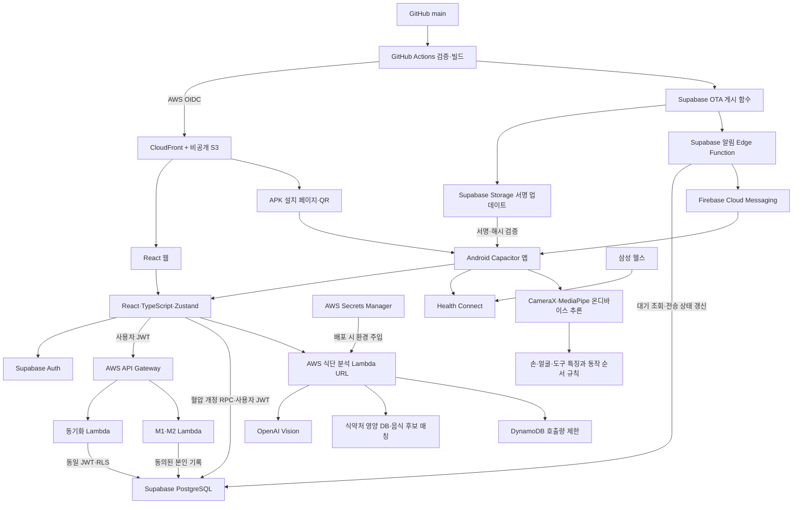

# REXRUN 시스템 아키텍처

2026-11-03 · 공개 서비스 응답, 앱 설정, 배포 코드 기준. 웹/APK의 실제 게시 커밋과 버전은 [release.json](https://d4vy5vn0lhbgi.cloudfront.net/release.json)에서 확인한다. AWS 관리 세션 재인증 없이 공개 health와 고정 합성 데모만 조회했으며 실제 사용자 건강 기록은 조회하지 않았다.

## 앱과 기기

웹은 React·TypeScript·Vite, 상태 관리는 Zustand, 비동기 분석 응답은 TanStack Query를 사용한다. Android는 같은 UI를 Capacitor WebView에서 실행한다. 건강 서베이·게임 상태·복약 기록의 기기 캐시와 미전송 변경을 유지하고, 데모 저장 공간은 실제 로그인 계정과 분리한다.

삼성 헬스 기록은 Health Connect 권한을 통해 읽는다. 전면 카메라는 새 APK의 네이티브 `MotionVision` 플러그인이 CameraX와 MediaPipe 얼굴·손 추론을 실행하고, 웹에서는 Worker 경로를 사용한다. 영상 전체를 WebView 브리지나 AI 서버로 보내지 않고 특징을 동작 순서 규칙에 전달한다. 현재 물 마시기·경구 복약·펜/주사 과정은 개별 동작을 학습한 새 행동 분류 모델이 아니라 특징과 순서를 조합한 인식이다. 실제 섭취량·약 종류·투약 성공을 입증하지 않는다.

복약 시간 알림은 Android 로컬 알림, 서버 퀘스트/업데이트 알림은 FCM 경로다. 앱의 종료·백그라운드 제약은 OS의 영향을 받는다.

## 서버와 저장

| 구성                      | 역할                                  | 현재 경로                                                                          |
| ------------------------- | ------------------------------------- | ---------------------------------------------------------------------------------- |
| CloudFront·S3             | 웹, APK, 설치 QR, 출처 파일 제공      | AWS Sydney `ap-southeast-2`                                                        |
| API Gateway·동기화 Lambda | JWT 검증, 게임·프로필·복약 동기화     | `/v1/me`, `/v1/sync`, 기기·알림 API                                                |
| Supabase Auth             | 이메일·소셜 로그인, 사용자 JWT 발급   | REXRUN 프로젝트, Seoul `ap-northeast-2`                                            |
| PostgreSQL·RLS            | 본인 기록과 저장 동의 확인            | `user_profiles`, `health_profiles`, `medications`, `game_saves`, `sync_batches` 등 |
| 혈압 개정 RPC             | 측정 정보·정정·서버 수신 시각 보존    | `append_bp_history`, `bp_history_heads`, `bp_history_at`                           |
| Supabase Storage·Edge     | OTA 파일·서명 manifest 게시, FCM 알림 | 앱과 호환되는 네이티브 버전별 채널                                                 |

일일 설문과 현재 대시보드는 게임 스냅샷의 날짜별 기록을 호환 경로로 읽는다. 새 혈압 이력 테이블은 별도 동기화 경로이며, 관측 시각과 서버 이용 가능 시각을 분리해 미래 예측용 원자료를 보관한다. 두 동기화 경로를 하나의 분산 트랜잭션이라고 간주하지 않는다. 미연결·오프라인에서는 혈압 변경을 계정별 기기 저장소에 보관한다.

서버 개정 번호·수신 시각·소유자는 클라이언트가 지정하지 못한다. 기존 개정의 UPDATE·DELETE는 허용하지 않고 정정·미측정도 새 개정으로 추가한다. 보유 중인 개인정보의 계정 삭제는 FK cascade 경로이며 업무상의 정정과 별개다. [요구사항·ERD·RPC·검증](BP_MEASUREMENT_COLLECTION.md)

## AI 분석의 역할

| 분석                  | 현재 동작                                                                                | 실행 위치                                            |
| --------------------- | ---------------------------------------------------------------------------------------- | ---------------------------------------------------- |
| 대시보드 측정 분석    | 실제 혈압의 최근 값·날짜별 평균·기간 추세 표시                                           | 앱의 결정적 계산                                     |
| 혈압 기록이 없는 경우 | 생활습관 기반 측정 권고. 현재 혈압 확진·정상 판정으로 사용하지 않음                      | 앱 + 기존 M1 응답                                    |
| M1-S                  | `M1-20261020_150607-nested__base`, 피처 계약 `1.2.0`. 혈압 입력·혈압약 등 대상 제외 처리 | AWS 모델 Lambda                                      |
| M2                    | 계약 `0.2.0`, 측정·생활습관 확인 항목 규칙                                               | 같은 모델 Lambda                                     |
| Sub Quest             | 전날 실천과 M1·M2 응답을 참고하는 규칙 기반 순위                                         | 앱. 별도 학습 Ranker 서비스는 없음                   |
| 식단 CV               | 사진의 음식 후보 생성 → 식약처 DB 매칭 → 사용자 종류·중량 확인 → 영양 계산               | AWS 식단 Lambda + OpenAI Vision (`gpt-4o` 배포 설정) |
| 미래 혈압 예측        | 서버 수신 시각을 반영하는 연구 프로토타입과 변환기. 실제 서비스 예측은 비활성            | `ai/bp_forecast`, 로컬 연구 코드                     |

운영 M1 health와 고정 90일 합성 데모 응답에서 기존 모델 버전과 M2 계약을 확인했다. 이번 대시보드·수집 배포는 EBM v9나 다른 재학습 후보를 운영 모델로 활성화하지 않는다. 식단·모션의 기존 배포 모델도 이번에 교체하지 않는다. 식단 사진을 외부 Vision에 전송하는 경로와 기기 내 모션 추론은 분리돼 있다. 식단 결과는 자동 섭취 확정 기록이 아니라 사용자가 확인하는 후보·추정치다.

## 배포와 검증 경계

`feature/* → develop → release/* → main`을 PR과 merge commit으로 반영한다. `main` push 후 Actions가 lint·format·단위·전체 브라우저 4분할·Android 컴파일을 통과해야 production 단계가 열린다. AWS 장기 키 대신 GitHub OIDC를 사용하고, 기존 APK·OTA 서명 계보를 유지한다. 웹·APK·설치 페이지·네이티브 호환 OTA 채널을 게시하고 원격 파일 해시를 재검증한다. 현재 네이티브 버전은 `1.7.0 (13)`이며 웹 버전은 Actions 실행 번호로 결정된다.

DB 마이그레이션은 웹 게시 전에 별도로 적용·검증한다. 새 혈압 기능은 기존 테이블의 데이터를 이전하거나 원래 값을 덮어쓰지 않는 추가 변경이다. 본인 외 조회 차단, 변경 재전송, 원본 보존, 과거 시점 복원과 동시 수정 충돌을 검증한다. 배포 출처는 공개 `release.json`, 검증 실행은 GitHub Actions에 남긴다.

독립적인 실제 종단 학습·외부 검증이 완료되기 전에는 미래 혈압 수치나 임상 성능을 제공하지 않는다. 현재 대시보드의 실천 점수는 걸음·퀘스트·수면 달성률이며 질환 확률과 별개다. [배포 절차](../deployment/README.md) · [예측 설계](BP_HISTORY_PREDICTION_DESIGN.md)
