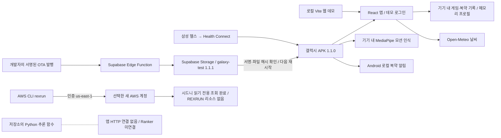
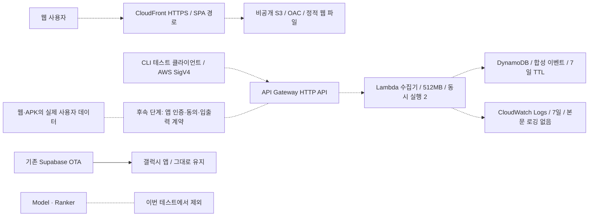

# REXRUN 연결 상태 — 2026-10-19

> 이 문서는 배포 전 사전 연결 구상 기록이다. 2026-10-20의 실제 AWS 웹/API → Supabase RDB·인증·푸시 연결은 [최신 구조도·ERD](../../docs/architecture/SYSTEM_DATABASE_AND_AWS.md)를 따른다. 아래 DynamoDB·SigV4 준비안은 현재 배포 구성이 아니다.

작업 브랜치: `feature/pixel-adventure-device-quests`. 실선은 확인한 현재 경로, 아래 별도 준비도는 미배포 구성이다.

공유용 PNG/SVG 도식, 현재 저장 키와 수집용 테이블 상세는 [현재 DB 구조와 AWS 연결 구상](../../docs/architecture/SYSTEM_DATABASE_AND_AWS.md)에 정리했다.

## 현재 연결

- 앱의 로그인은 데모 세션이다. 계정 서버·프로필 동기화·임상 판정 서비스는 연결되지 않았다.
- MediaPipe는 카메라 모션 인식용이며 건강 위험도 Model과 다르다.
- 수집 API와 AWS 웹 호스팅은 아직 배포되지 않았다. 현재의 API 목록·테이블 목록은 빈 목록이며 조회 실패를 빈 목록으로 간주하지 않았다.
- 계정 Free Tier 플랜 조회는 `ResourceNotFoundException`으로 미확정이다. 무료·크레딧 잔액·조직 전체 청구액이 0임을 의미하지 않는다.
- Supabase OTA manifest 1.1.1의 서명과 샘플 객체 해시를 이번 작업에서 재확인했다. 설정·서명 키·채널·배포 파일은 변경하지 않았다. 갤럭시의 실제 업데이트 설치/재시작은 별도 실기기 검증 사항이다.

## 준비한 AWS 테스트 구성 — 미배포

수집기는 장래의 건강정보 서버가 아니라 연결 확인용이다. `synthetic: true`인 고정 형태의 이벤트만 받으며 이름·혈압·복약·자유 텍스트를 거절한다. 현재 앱/모바일에는 AWS 자격 증명을 넣지 않는다. 초기 SigV4 테스트가 끝난 뒤 실제 앱 사용자 인증과 계약이 결정되어야 모바일에서 사용자 데이터를 보낼 수 있다.

설계 근거: [CloudFront OAC](https://docs.aws.amazon.com/AmazonCloudFront/latest/DeveloperGuide/private-content-restricting-access-to-s3.html), [HTTP API IAM 인증](https://docs.aws.amazon.com/apigateway/latest/developerguide/http-api-access-control-iam.html), [DynamoDB TTL](https://docs.aws.amazon.com/amazondynamodb/latest/developerguide/TTL.html).
